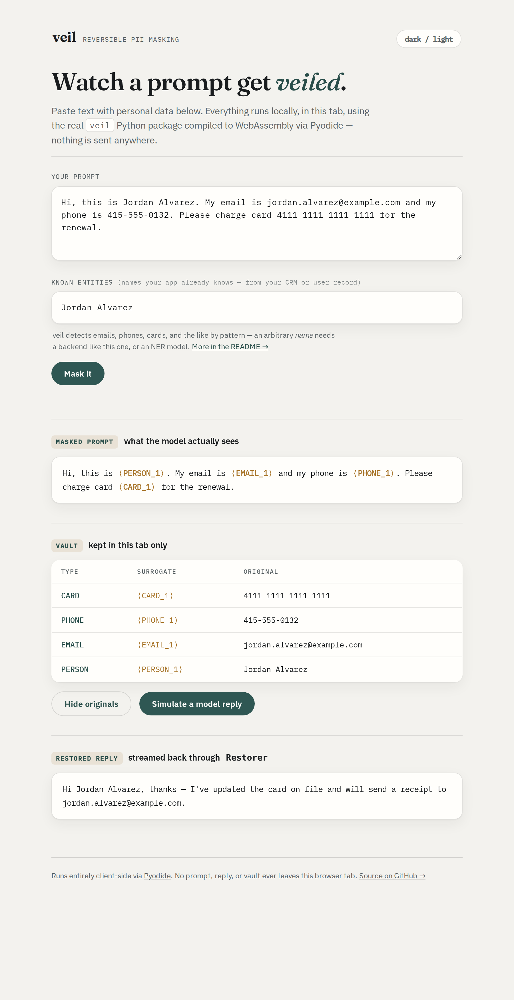
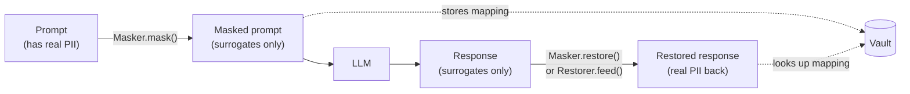
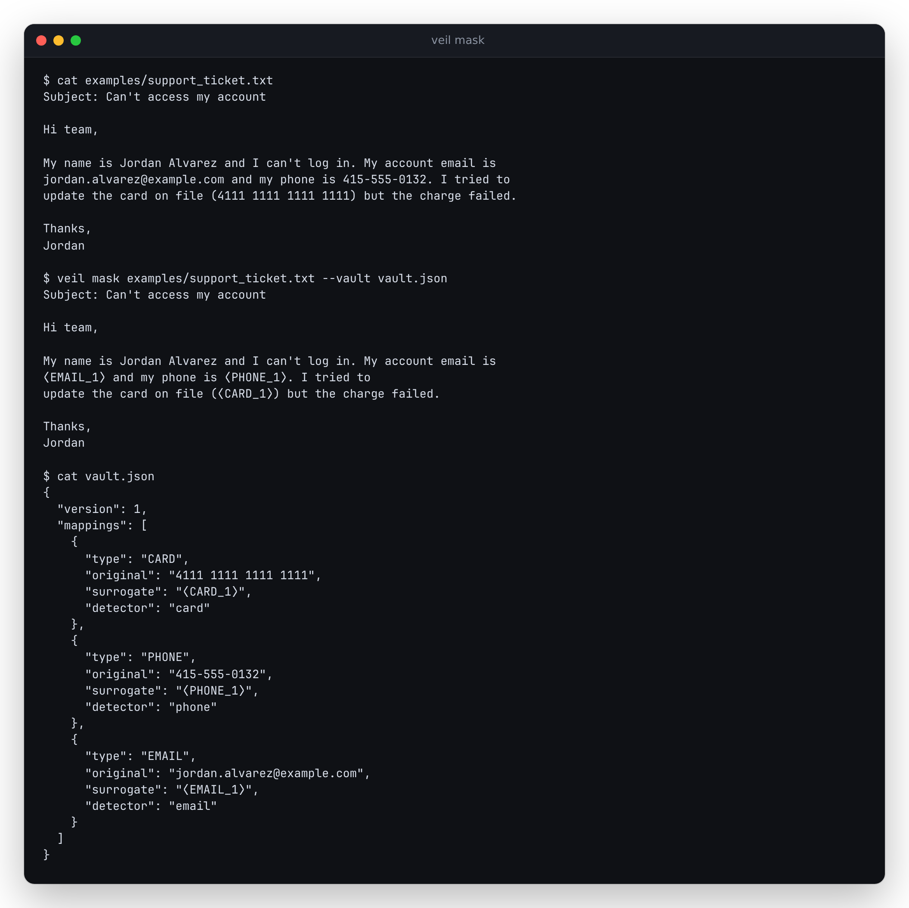
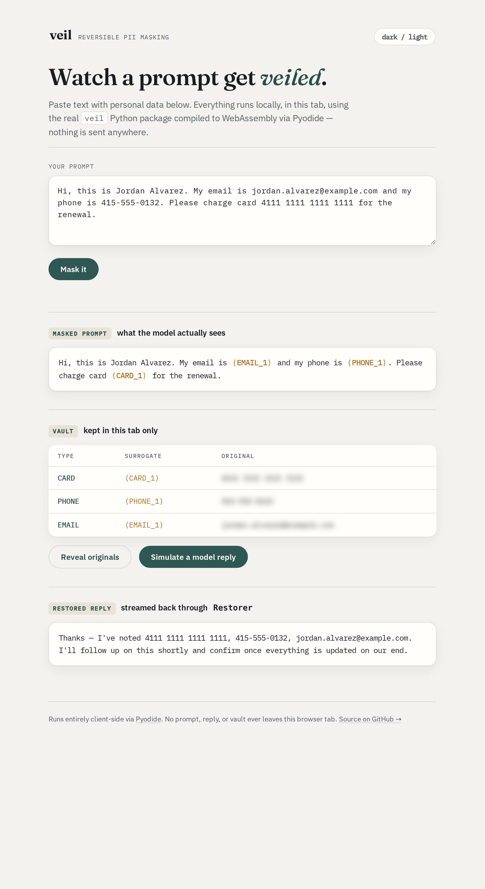

# veil

**Reversible PII masking for LLM calls.** Mask personal data before the
prompt leaves your network, let the model reason over consistent
surrogates, and restore the originals in the answer — streaming included.

[](https://pypi.org/project/veil-pii/)
[](LICENSE)
[](https://antonsoo.github.io/veil/)
[](https://huggingface.co/spaces/antonsoloviev/veil)



**[Try the live demo →](https://antonsoo.github.io/veil/)** — runs the
real Python package in your browser via [Pyodide](https://pyodide.org),
nothing leaves the page: its Content-Security-Policy lets it talk to its own
origin and to the CDN Pyodide is downloaded from, and to nothing else.
(`web/`; see [Web demo](#web-demo) below.)

## On real text

veil's own benchmark is a corpus its generator wrote, and it scores 1.000 on
it. [A study in this repository](studies/real-text/README.md) ran it instead on
text nobody wrote for it: phone numbers and email addresses as people typed
them into OpenStreetMap in 46 cities, and 2.6 million words of system logs, CI
logs and source code, where almost nothing should be masked.


- **0.4.4 masked 66% of 16,659 phone numbers written with a `+`**: 99% in the
  United States, 9% in France, 7% in Japan. It expected digits in groups of
  two to four. The detector now reads the calling code and checks the length
  that country uses: 99.9%, and 99.3% in 24 cities it was not changed against,
  where 0.4.4 found 53.9%.
- **In logs and code 0.4.4 masked eleven things per 1,000 words that were not
  what it called them**: 16,965 file paths and test names as secrets, 941
  timestamps and block ids as card numbers, `::` as an IPv6 address. Now 0.12
  per 1,000, and 0.04 on a million words held out.
- **It caught 13% to 65% of random 20-character keys**, because its entropy
  threshold was one a short key cannot reach and a file path can. Now 92% to
  97%.
- Email addresses held up: 5,011 of 5,019. Numbers written without a `+`
  outside North America are still missed.

These changes are in this repository and not yet in a release; `pip install
veil-pii` gets 0.4.4.

**Source update: mask the whole mailbox.** `first!last@example.org` previously
became `first!⟨EMAIL_1⟩`, exposing part of the identity in outgoing SDK requests.
The source detector now covers full ASCII dot-atoms, supported international
and quoted local parts, and Unicode/punycode domains. A fresh recheck of the
retained contact corpus fully masks eight more email tags. Exact restoration,
actual SDK transport captures and syntax ambiguities are documented in the
[mailbox study](studies/email-boundaries/README.md). The source and live browser
demo include this correction; the PyPI package remains unchanged.
The source also consumes [all four IDNA domain separators](studies/idna-mailboxes/README.md):
an ideographic/fullwidth/halfwidth dot previously left a private domain suffix
visible or bypassed mailbox detection. Original spellings restore exactly.

The [2026-10-15 deployment record](studies/jwt-claims/README.md#public-source-and-hosted-demo)
verifies all 27 served build files and actual offline workflows for IDNA
mailboxes, temporary AWS key IDs and whole JWTs in both browser engines.

**A literal example must not become someone's address.** The source checkout
also corrects a masking collision: a prompt containing an email and the literal
token `⟨EMAIL_1⟩` previously used that token for both. Restoring the prompt
changed the example into the address. Allocation now reserves source literals,
and ambiguous reused mappings stop before output or an SDK request is sent.
[Reproductions, actual SDK captures and browser downloads](studies/surrogate-collisions/README.md)
show the correction and its limits. This change is not in the PyPI release.

## Why this exists

Teams in healthcare, legal, finance, and support want to use hosted LLMs,
but their prompts contain customer names, emails, phone numbers, card
numbers, account IDs, and API keys. The usual answer is "redact it" —
replace the value with `[REDACTED]`. That breaks the response: the model
can't say "Dear [REDACTED], your order [REDACTED] ships tomorrow."

Reversible pseudonymization fixes that instead: replace each sensitive
value with a consistent surrogate, let the model reason over the
surrogates, and map them back in the response. The model never sees the
real data; the human on the other end never sees a redaction. The part
almost nobody handles is doing that restoration on a *stream* of tokens,
where a surrogate can be split across chunk boundaries — that's most of
what this repository is about.

## How it works



1. **Detect.** Regex-and-validation detectors (Luhn, mod-97, structural
   checks) find emails, phone numbers, cards, IBANs, SSNs, IPs,
   credential-bearing URLs, API keys, and dates of birth. A pluggable
   backend finds names/orgs/locations — see "Names, orgs, and locations"
   under [Features](#features) below.
2. **Mask.** Each detected value gets a surrogate — either a placeholder
   token (`⟨EMAIL_1⟩`) or a realistic fake (`user1@example.com`) — and the
   `(original, surrogate)` pair is recorded in a `Vault`. The same
   original always maps to the same surrogate for the life of the vault.
3. **Send.** The masked text goes to the LLM. It never sees the real
   values.
4. **Restore.** The response comes back full of surrogates. `restore_exact`
   / `restore_tolerant` swap them back for a buffered response;
   `Restorer.feed()` does it token-by-token for a stream.

### The streaming problem, concretely

Say the vault maps `⟨EMAIL_1⟩` to `alice@example.com`, and the model
streams its reply in small chunks:

```
chunk 1: "Sure, I'll email ⟨EM"
chunk 2: "AIL_1⟩ right away."
```

A restorer that looks at each chunk in isolation emits `⟨EM` verbatim (the
placeholder leaks into what the user sees) and then has no memory of it
when `AIL_1⟩` arrives in the next chunk. `veil.restore.Restorer` instead
recognizes that `⟨EM` is a valid *prefix* of a known surrogate, holds back
only that trailing fragment, and completes the match once `AIL_1⟩`
arrives — emitting `alice@example.com right away.` with nothing leaked
and no extra latency beyond the one held-back fragment. It's built on a
trie over the vault's surrogate strings (see `veil/restore.py`), and
Hypothesis property tests prove that *any* way you split a given text
into chunks produces output identical to restoring it unsplit
(`tests/test_restore_streaming.py`).

## Quickstart

```bash
pip install veil-pii
```

```python
from veil import Masker

masker = Masker()
masked = masker.mask("Email alice@example.com about invoice #4471.")
print(masked)  # "Email ⟨EMAIL_1⟩ about invoice #4471."

# ... send `masked` to your LLM of choice, get `reply` back ...
reply = "Sure, I've noted it for ⟨EMAIL_1⟩."
print(masker.restore(reply))  # "Sure, I've noted it for alice@example.com."
```

### With the Anthropic SDK

```bash
pip install "veil-pii[anthropic]"
```

```python
from anthropic import Anthropic
from veil.integrations.anthropic import AnthropicVeil

client = AnthropicVeil(Anthropic())

response = client.create(
    model="claude-opus-5-5",
    max_tokens=1024,
    messages=[{"role": "user", "content": "Email alice@example.com about invoice #4471."}],
)
print(response.content[0].text)  # the real address, restored — Claude only ever saw a surrogate

# Streaming:
with client.stream(model="claude-opus-5-5", max_tokens=1024, messages=[...]) as stream:
    for text in stream.text_stream:  # already restored, split-token-safe
        print(text, end="", flush=True)
```

All three of the SDK's ways to stream come back restored: `stream.text_stream`,
iterating the stream's events (the API's deltas, and the SDK's own `text` and
`input_json` events and the snapshots on `content_block_stop` and
`message_stop`), and the raw event iterator of `create(..., stream=True)`.
Tool-input JSON is restored as its fragments arrive. Text held back because it
might begin a surrogate is released before its block's `content_block_stop`.
`AsyncAnthropicVeil` is the same wrapper for `AsyncAnthropic`:

```python
from anthropic import AsyncAnthropic
from veil.integrations.anthropic import AsyncAnthropicVeil

client = AsyncAnthropicVeil(AsyncAnthropic())
response = await client.create(model="claude-opus-5-5", max_tokens=1024, messages=[...])
async with client.stream(model="claude-opus-5-5", max_tokens=1024, messages=[...]) as stream:
    async for text in stream.text_stream:
        print(text, end="", flush=True)
```

**Inline documents (source checkout, unreleased).** Anthropic document `title`,
`context`, plain-text `source.data` and custom-content text now pass through
masking, including documents inside tool results. Previously all three example
contacts reached the SDK transport unchanged in each of the 36 retained requests.
[Before/after SDK captures and supported forms](studies/anthropic-documents/README.md).
PDF/image bytes and URL/file references remain opaque; sanitize them separately.
Returned citation quotes and locations stay exactly as the provider supplied
them and refer to the **masked source**, not character offsets in your original
document. Answer text is restored normally. The wrapper does not map citation
coordinates back to original text.

**Retrieved search results (source checkout, unreleased).** Anthropic
`search_result` source labels, titles and text blocks now pass through masking,
including results inside tool responses and content supplied as an iterator.
Previously all four recognized contacts reached transport unchanged in each of
36 SDK workflows. Citations retain the masked attribution and quotes; their
result/block indices and retained assistant replay stay intact.
[Before/after captures and citation boundaries](studies/search-results/README.md).

**Tool-input serialization (source checkout, unreleased).** Tuple values used
to bypass masking before the SDK turned them into JSON arrays. Custom model
objects and sensitive dictionary keys could also carry raw recognized
identifiers to transport. Fresh tool inputs now use plain JSON trees: tuple
entries are masked, detected sensitive keys reject, and opaque objects must be
serialized explicitly first, such as `contact.model_dump(mode="json")`.
Numbers, booleans and null retain their types. The
[44-workflow SDK replay](studies/tool-input-trees/README.md) captures 24 raw-value
request cases before and none after, across sync/async create and streaming
calls. Unchanged retained provider history still replays exactly; that history
is separate from fresh caller input.

### With the OpenAI SDK

`veil.integrations.openai.OpenAIVeil` (the `openai` extra) wraps both of
OpenAI's APIs: `create` / `stream` for Chat Completions, and
`create_response` / `stream_response` for the Responses API. Passing
`stream=True` to `create` or `create_response` streams the same way, restored.
`AsyncOpenAIVeil` is the same wrapper for `AsyncOpenAI` (`await` each call,
`async for` over a stream).

```python
from openai import OpenAI
from veil.integrations.openai import OpenAIVeil

client = OpenAIVeil(OpenAI())

response = client.create_response(
    model="gpt-6-sol",
    instructions="You draft customer emails.",
    input="Email alice@example.com about invoice #4471.",
)
print(response.output_text)  # restored; the model only saw ⟨EMAIL_1⟩

for event in client.stream_response(model="gpt-6-sol", input=[...]):
    if event.type == "response.output_text.delta":
        print(event.delta, end="", flush=True)  # restored, split-token-safe
```

For the Responses API, veil masks `instructions` and every message,
`function_call`, `function_call_output` and custom tool item in `input`. It
restores message text, refusals, tool-call arguments and reasoning summaries
in `output`, and `response.output_text` with them, since the SDK computes it
from `output`. Reasoning items pass through untouched. In a stream, text and
argument deltas are restored as they arrive, and any text held back because
it might begin a surrogate is released, as one more delta event, before the
matching `.done` event. With `previous_response_id` the server keeps the
masked history, so keep the same `OpenAIVeil` (and its vault) for the whole
conversation.

In a Chat Completions stream every choice has its own restorers (`n > 1`
choices arrive interleaved, and so do parallel tool calls), refusals are
restored like content, and held-back text is released in the chunk that
carries the choice's `finish_reason`, so nothing arrives after a choice has
finished or after the usage chunk.

The source checkout also masks Chat Completions refusal history (both the
`refusal` message field and refusal content parts), legacy
`function_call.arguments`, and custom-tool `input`. Complete replies restore
those fields too; retained unchanged replies still replay the exact provider
spelling. Previously, these history fields could pass raw contacts through
to the SDK request body. The correction is unreleased.
[Actual SDK before/after captures](studies/chat-text-fields/README.md) cover
sync/async calls, both streaming entrypoints, complete replies and failed
request preparation. Streaming output restoration continues to cover text,
refusals and modern function-tool arguments.

Inline text arrays in the source checkout are visited before SDK serialization,
including tuples and generators: Chat content parts, Responses input items,
message/tool-output parts and reasoning summaries. Equivalent non-list arrays
previously sent unmasked contacts. Lists and tuples are copied; a one-shot
iterator is consumed during preparation and cannot be rewound if preparation
fails. Vault changes still roll back before transport. Image/file references
and encrypted reasoning remain opaque.
[Captured array-shape workflows](studies/iterable-text/README.md) retain the
before/after evidence. This correction is unreleased.

**How the wrappers are tested.** There is no API key in this repository and
no live call. `tests/test_sdk_anthropic.py` and `tests/test_sdk_openai.py`
run the real SDKs (sync and async clients) over a mocked HTTP transport that
answers in the APIs' wire format, so the messages, chunks and events veil
restores there are the ones the SDK builds for an application; a property
test cuts a reply at arbitrary points and requires the same restored text.
The other integration tests use fakes shaped like the SDK types.

### Multi-turn conversations and tool calls

Keep your history the normal way: append the assistant turn veil handed
you (real values restored, including in the `tool_use` input your code is
about to execute) and send the whole list on the next call. The wrapper
remembers the blocks the model produced and swaps retained, unchanged assistant
history back in before the request leaves. Keep the returned content/message
objects in history: they identify their original occurrence even when different
replies restore to the same text.

- **Restored values are masked again or replayed as their surrogates.** Tool-call
  arguments are the easy thing to leak: they are real by design, because
  your code has to act on them.
- **Retained history keeps the provider's original content.** Re-masking a restored turn
  only approximates the original (a support address the model wrote
  itself looks like PII and would get a fresh surrogate). Changing an earlier
  turn can interrupt prompt-cache reuse. Thinking blocks and their signatures
  are passed through unchanged.

**Message boundaries and history identity (source checkout).** Anthropic
`text_stream` and `get_final_text()` now restore each content block before
joining text. A placeholder split between two different blocks stays literal;
it cannot invent a contact from the vault. User messages always go through
masking, even when they repeat an assistant reply. Adding or removing a JSON
`null` in tool inputs counts as an edit.

Copied dictionaries and plain strings can be replayed only when their content
identifies one provider value and the cache has never evicted a content entry.
After an eviction, forgotten history could contain another original for the
same restored value, so content-only matches raise `VaultError`. Unchanged
retained objects (including blocks in a rebuilt content list) still identify
their own originals. If two different replies restore to identical
content, ambiguous reconstructed history raises `VaultError` before transport,
and request preparation rolls back its vault changes. Keep the returned
Anthropic `response.content` or Chat Completions `response.choices[0].message`
objects to distinguish those occurrences. The cache retains at most 10,000
content fingerprints and 10,000 object identities per wrapper. Edited or
unrecognized history is masked afresh; a known ambiguous match still fails.
Provider snapshots and outbound replay copies
are separate, so later mutations cannot rewrite saved history.
[Synthetic SDK captures and reproduction](studies/message-boundaries/README.md)
show the exact before/after behavior. These changes are not yet released to PyPI.

A turn veil didn't produce (or one you edited) is masked like any other
message. In the source checkout, OpenAI tool-call arguments are decoded before
masking: `{"to":"alice\u0040example.org"}` contains an email even though its raw
JSON spelling has no `@`. Only changed string values are rewritten; object
structure, numeric spelling, duplicate members and untouched escapes are kept.
Malformed JSON or a detected sensitive field name raises `VaultError` before
the request is sent, with the request's vault changes rolled back. Put sensitive
data in string values, not field names or numeric values. This fix is not yet in
the PyPI release; [inspect the actual SDK captures](studies/json-tool-arguments/README.md).

OpenAI tool-call arguments arrive as a JSON string; veil decodes string values
before restoring, so a surrogate the model wrote with `\u27e8`-style
escapes is still found, and restored values are escaped so the arguments
stay valid JSON.

Complete replies now preserve unrelated JSON tokens too. Restoring an address
must not round an amount, discard repeated members or convert a large exponent
to `Infinity`. [Captured complete replies](studies/json-tool-restoration/README.md)
record these corrections; they are not yet in the PyPI release.

Streamed arguments use the same JSON string boundaries: mixed and uppercase
Unicode escapes restore correctly, while literal backslashes, object keys and
numbers remain unchanged. Feed `Restorer(vault, json_string=True)` from the
beginning of the JSON document. It transforms string values incrementally;
it does not validate or repair malformed JSON.

**Complete IPv6 literals (source checkout).** Mixed addresses such as
`2001:db8::192.0.2.33` and scoped addresses such as `fe80::1%en0` now become
one surrogate. Previously, the mixed address left `.0.2.33` visible and the
scoped address left `%en0` visible. Exact restoration preserves the original
spelling. [Recognition policy and before/after evidence](studies/ip-literals/README.md)
cover reserved-space exceptions, malformed-input controls and SDK transport.

## Features

- **Detectors** (`veil.detectors`): email, phone (NANP, or international
  with an explicit `+`, an assigned calling code and a length that country
  uses, in any grouping — no unprefixed generic fallback; see the module
  docstring for why),
  payment card (Luhn, plus an issuer's range or a card's printed grouping),
  IBAN (mod-97 + per-country length),
  US SSN (excluding never-issued ranges), IPv4/IPv6 (a dotted quad labelled
  as a version is left alone, and so are loopback, the unspecified address
  and most reserved space), credential-bearing URLs of any scheme
  (including `postgres://`/`redis://`-style connection strings), PEM private
  key blocks, API keys/secrets (`AKIA…`, `ghp_…`, `github_pat_…`, `xox…`,
  `sk_live_…`, `sk-ant-…`, `sk-proj-…`, `sk-svcacct-…`, `sk-…`, plus a heuristic for random tokens that
  leaves alone anything that reads as words),
  context-gated date-of-birth, and an opt-in US street-address heuristic.
  This checkout masks complete project/service-account-shaped token bodies;
  the released package is unchanged. [Synthetic SDK replay and scope](studies/secret-formats/README.md)
  explain the recognition heuristic and its limits.
  The source also recognizes temporary AWS `ASIA` key IDs independently of
  entropy/word heuristics. [Seeded coverage and actual SDK requests](studies/sts-key-ids/README.md)
  retain the previously missed cases; this correction is unreleased.
  The source also masks supported compact JWTs as whole credentials, covering
  encoded identity claims that fragment masking left visible.
  [Native signature oracles and SDK captures](studies/jwt-claims/README.md)
  document recognition boundaries; this change does not authenticate tokens.
  This checkout also recognizes signed AWS/GCS, Azure Storage SAS and
  CloudFront URLs, OAuth fragment tokens, and percent-encoded token parameter
  names. [Credential-URL evidence and exact matching rules](studies/credential-urls/README.md)
  cover whole-URL masking, ordinary-link controls and restoration.
- **Names, orgs, and locations** via a pluggable `NameBackend`: a
  first-class `KnownEntitiesBackend` (you already know the customer's name
  from your own database — this is the most reliable option in practice)
  and an optional `SpacyBackend`.
- **Surrogates**: placeholder tokens or realistic format-preserving fakes
  (fake names, `example.com`/`example.org` emails per RFC 2606, `555-01xx`
  NANP phone numbers, Luhn-valid test-range card numbers), consistent
  within a session.
- **Restore**: exact (byte-for-byte) and tolerant (case changes,
  possessives, a surrogate split across a line wrap) — see
  `veil/restore.py` for exactly what "tolerant" does and doesn't cover.
- **Streaming restore**: `Restorer.feed(chunk) -> str` / `.flush() -> str`,
  proven equal to non-streamed restore under arbitrary chunking.
- **Leak audit** (`veil.audit`): checks outgoing text for original values
  that should never reappear, and flags *new* PII the model introduced.
- **Vault**: in-memory by default, JSON-serializable, optional Fernet
  encryption at rest (`veil-pii[vault-crypto]`) — see the threat model in
  `veil/vault.py`.
- **CLI**: `veil mask`, `veil restore`, `veil audit`.
- **SDK integrations**: thin wrappers for the Anthropic Messages API and
  OpenAI's Chat Completions and Responses APIs, for sync and async clients,
  that mask every outgoing message (tool calls included), restore responses
  and every way of streaming them, and replay earlier assistant turns exactly
  as the model produced them.
- **Zero runtime dependencies in the core.** Everything above the
  detectors/surrogates/restore/vault/CLI layer is an optional extra.

## CLI

```bash
$ veil mask examples/support_ticket.txt --vault vault.json --name "Jordan Alvarez" --name Jordan
Subject: Can't access my account

Hi team,

My name is ⟨PERSON_1⟩ and I can't log in. My account email is
⟨EMAIL_1⟩ and my phone is ⟨PHONE_1⟩. I tried to
update the card on file (⟨CARD_1⟩) but the charge failed.

Thanks,
⟨PERSON_2⟩

$ veil restore masked_reply.txt --vault vault.json
$ veil audit outgoing_reply.txt --vault vault.json   # exit 1 if anything leaked
```

An email address or a card number has a shape; a name has none, so the names
are yours to give: `--name`, `--org` and `--location` (each repeatable), or
`--names-file` with one per line. Without them the ticket above keeps "Jordan
Alvarez" in it.

Each command reads stdin when no file is named and writes stdout, so they sit
on either side of a model call; `-o FILE` writes a file instead:

```bash
$ cat ticket.txt | veil mask --vault vault.json | your-llm-call | veil restore --vault vault.json
$ veil mask ticket.txt --vault vault.json -o masked.txt
```

The CLI saves the vault before emitting masked text. File writes replace a
temporary sibling atomically and use owner-only permissions on POSIX. Input,
output, names files and the vault must be distinct paths, including aliases.
These protections do not encrypt a plaintext vault or coordinate concurrent
writers. See [session integrity](docs/session-integrity.md) for the exact contract.

Input and output are UTF-8 on every path, pipes included, whatever the
system's code page; line endings pass through unchanged. In Windows
PowerShell, prefer `-o` to `>`, which re-encodes what a program prints.



## Literal tokens and related messages (source checkout)

Use `mask_many` when several raw texts will share one vault. Every source is
reserved before new replacements are chosen:

```python
from veil import Masker

masker = Masker()
masked = masker.mask_many(["Contact alice@example.org", "Example: ⟨email_1⟩"])
assert masked == ["Contact ⟨EMAIL_2⟩", "Example: ⟨email_1⟩"]
assert [masker.restore(text) for text in masked] == [
    "Contact alice@example.org",
    "Example: ⟨email_1⟩",
]
```

`mask` checks one text; `mask_many` checks the supplied batch. Exact and tolerant
restoration must reproduce each source. A collision with an existing identity
raises `VaultError` and leaves the vault's mappings and counters unchanged.
The CLI returns exit 2 without replacing its output or vault file. Existing
identities are never silently renamed.

SDK wrappers validate all raw text they mask for one request before calling the
SDK, including separate system/instruction and tool-argument fields. If a later
field collides with a token already allocated during preparation, the whole
preparation fails and rolls back. Choose a fresh vault and a placeholder
template absent from the complete request when retrying; do not feed pre-masked
strings back into a masking wrapper. The [study](studies/surrogate-collisions/README.md)
explains what is and is not covered.

## Web demo

[antonsoo.github.io/veil](https://antonsoo.github.io/veil/) runs the
*actual* `veil` Python package in the browser via
[Pyodide](https://pyodide.org) (loaded from cdn.jsdelivr.net) — the
`web/scripts/copy-veil-src.mjs` build step bundles `src/veil`'s real
source (zero runtime dependencies makes this possible with no wheel
build) so the demo is never a JS reimplementation drifting from the
library. Paste a prompt, optionally list names your app already knows
(wired to `KnownEntitiesBackend`), mask it, and watch a simulated reply
stream back through the real `Restorer`, one random-sized chunk at a
time — dark mode:



Everything — Pyodide, the package source, the whole interaction — stays
in that browser tab; nothing is sent anywhere, which the page itself
says. Built with Vite + TypeScript in `web/`; `npm run dev` there for
local development.

## Measured results

On real text, see [the study](studies/real-text/README.md) and the summary
[above](#on-real-text). What follows is the synthetic corpus: a check that
each validation is implemented correctly, not a measure of how veil does on
what people actually write.

Measured on this machine (14 vCPU WSL2 Linux, 48 GB RAM) by running
`scripts/evaluate.py` against `benchmarks/corpus.jsonl` — a 240-document,
6-category **synthetic** corpus generated by `scripts/generate_corpus.py`
with a fixed seed (reproduce with
`uv run python scripts/generate_corpus.py 40 > benchmarks/corpus.jsonl`).

| Detector | Precision | Recall | F1 |
|---|---|---|---|
| Address (heuristic) | 1.000 | 1.000 | 1.000 |
| Card | 1.000 | 1.000 | 1.000 |
| DOB | 1.000 | 1.000 | 1.000 |
| Email | 1.000 | 1.000 | 1.000 |
| IBAN | 1.000 | 1.000 | 1.000 |
| IPv4 | 1.000 | 1.000 | 1.000 |
| Phone | 1.000 | 1.000 | 1.000 |
| Secret | 1.000 | 1.000 | 1.000 |
| SSN | 1.000 | 1.000 | 1.000 |
| **Total** | **1.000** | **1.000** | **1.000** |

**Benign false positives: 0.00 per 1,000 words**, measured over the
corpus's `clean_negative` and `benign_numbers` categories (80 documents,
4,155 words of ordinary business text with zero PII, deliberately
saturated with the numeric shapes that most look like phone numbers or
SSNs: ISO/DMY dates, times, `#order-1234` and `INV-`/ticket IDs, ZIP+4,
carrier tracking numbers, prices, room numbers, and version/build
strings — the exact categories a naive digit-group detector over-masks).
0.00 here means specifically "no false positive on *these* known-tricky
shapes", not "no false positives on arbitrary text". On 1.6 million words of
real logs and source code the released 0.4.4 made 11.3 per 1,000 words, and
this checkout makes 0.12.

**Masking throughput:** ~1.6-2.1 MB/s (single-threaded, all nine
detectors run on every document; varies run to run — see `elapsed_s` in
the script's output). Time grows in step with the input: a 270 KB export
holding 16,000 values masks in 0.65 s and restores in 0.22 s, and
`tests/test_scale.py` keeps it that way. Those measurements concern one text.
The source checkout also speeds up batches of many short texts: a constructed
8,000-message batch drops from 9.87 s to 0.51 s, with identical masked text,
vault and round trips. A 4,000-block inline document through the actual SDK's
local mock transport drops from 2.78 s to 0.57 s. The
[batch study](studies/batch-reservations/README.md) records the host, all samples,
controls and limits. This improvement is not in the PyPI release.

**Streaming-restore overhead:** within roughly ±20% of non-streamed
restore at a 24-character chunk size, on the same corpus — noise-level on
this machine, not a meaningful cost.

**Read the "1.000" row honestly** — see [Accuracy and
limitations](#accuracy-and-limitations). This corpus was built to
independently verify each detector's *validated* claims (a real Luhn
check, a real mod-97 check, real NANP/E.164 structure, real never-issued
SSN ranges — see [How it works](#how-it-works)), so a clean score mostly
means those checks are implemented correctly, not that real-world text is
this easy. The corpus generator and the benign-numbers check both found
and fixed real precision bugs during development — most recently the
phone detector masking an ISO date and an order number as phone numbers
in ordinary support text, and the SSN detector matching a ZIP+4 code
(`22156-7224` parses as area+group+serial if separators aren't required
to be consistent). See the git history for `fix: detector false
positives found via synthetic corpus evaluation` and the phone/SSN
over-masking fix that followed it.

## Accuracy and limitations

- **Detection is never perfect.** Every regex-and-validation detector here
  has a documented failure mode in its own module docstring (e.g.
  `veil/detectors/phone.py` explains exactly which phone formats it
  deliberately won't match, and why). Read those before relying on this
  for a compliance-sensitive workload.
- **Names need a backend.** Out of the box, veil does not detect person,
  organization, or location names — those require
  `KnownEntitiesBackend` (recommended: you almost always already know the
  customer's identity) or an optional, *unbenchmarked* spaCy backend. See
  `veil/backends/spacy_backend.py` for why we don't claim an NER accuracy
  number we haven't measured.
- **The SDK wrappers cover the calls they name.** `create` and `stream`
  (Messages, Chat Completions) and `create_response` / `stream_response`
  (Responses), on sync and async clients. The SDKs' other entry points
  (`client.chat.completions.stream()`, `client.responses.stream()`,
  `.parse()`, batches, `count_tokens`) are not wrapped: called on the
  underlying client they send what you pass, unmasked. A model's thinking
  text is passed through as it was signed, so it shows surrogates, not the
  originals.
- **JSON argument masking covers string values.** Numbers, booleans and null
  retain their types and are not anonymized. Encode sensitive identifiers as
  strings. JSON escape decoding applies to function-call `arguments`, whose
  format is specified by the API; it does not recursively interpret ordinary
  message text or custom-tool input as JSON. Exact replay of provider-produced
  history retains the provider's original arguments, including malformed ones.
  Fresh Anthropic tool inputs require string-keyed dictionaries, lists/tuples
  and finite JSON scalars. Detected sensitive keys cannot safely be renamed;
  they reject the request. Convert custom model objects to plain JSON before
  passing them to the wrapper. Tuple text participates in the same request
  collision checks and rollback as ordinary list/string content.
- **US-centric.** SSN and the address heuristic assume US formats. A phone
  number is found in the North American format, or in any country's when it
  is written with a `+`. Written the local way anywhere else
  (`03-1234-5678`, `080 2222 3333`), it is missed: 4 of 467 such numbers
  were found in [the study](studies/real-text/README.md), and half the
  Indian numbers there are written that way. There's no general
  international address, national-ID, or VAT-number detector yet.
- **Realistic surrogates can leak structure.** A format-preserving fake
  IBAN still reveals the real one's country; a fake card still reveals
  its network. See the trade-off discussion in `veil/surrogates.py`.
  Finite name, organization and phone pools fall back to numbered placeholders.
  The source checkout avoids collisions with the raw texts submitted together
  and rejects ambiguous restoration. It does not retain earlier raw texts:
  include the whole raw conversation in `mask_many` when extending one.
  Provider-held history, signed/replayed blocks and future model-generated
  literals are outside that check. Restoration alone cannot tell an incidental
  model-generated occurrence from an intended reference.
- **The vault is the whole game.** Anyone who reads the vault can
  de-anonymize the masked text — see the threat model in `veil/vault.py`
  before deciding where (or whether) to persist one.
- **Synthetic benchmarks overstate real-world performance.** The corpus
  above is clean, well-formatted, English-language, and generated by the
  same kind of logic the detectors use to validate — it is a correctness
  check, not a claim about messy real-world text (typos, non-US formats,
  mixed languages, OCR noise). The study measured the gap for phone
  numbers, email addresses and technical text. It did not measure personal
  prose: letters, chats, tickets, medical notes. Nor recall for real card
  numbers and live credentials, for which there is no public corpus.
- **Random is not the same as secret.** The token heuristic masks lockfile
  hashes, ETags and other generated ids at low confidence, because nothing
  in the token says which it is.

## Development

```bash
git clone https://github.com/antonsoo/veil
cd veil
uv sync --group dev
uv run pytest          # including Hypothesis property tests
uv run ruff check .    # lint
uv run mypy            # typecheck (strict)
```

Correctness is checked against independent oracles where one exists: the
Luhn checksum for cards, ISO 7064 mod-97 for IBAN (verified against
published Wikipedia example IBANs for GB/DE/FR), and the stdlib
`ipaddress` module for IP parsing — see the module docstrings in
`veil/detectors/` for details, and `tests/` for the corresponding tests.

## Contributing

See [CONTRIBUTING.md](CONTRIBUTING.md).

## License

[MIT](LICENSE) © 2026 Anton Soloviev

---

<sub>Part of [Officina](https://antonsoo.github.io/officina/), a set of small open-source tools by [Anton Soloviev](https://github.com/antonsoo).</sub>
