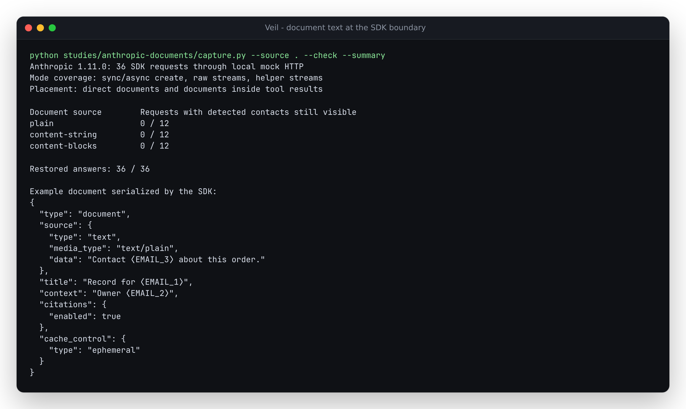

# Mask inline documents before the Anthropic SDK sends them

Veil masked an ordinary text message but passed an Anthropic `document` block
through unchanged. The body, title and context could therefore send values that
the same masker's detectors would have caught in message text.

The retained reproduction uses three synthetic example addresses, one per field,
through **Anthropic 1.11.0's actual SDK and a local mock HTTP transport**. It makes
no network or model calls. All 36 previous requests sent all three addresses
unchanged. The corrected requests send surrogates, and all 36 echoed answers
restore to the original body. This measures a traversal gap, not detector recall
on real documents or a production privacy incident.



## Covered request forms

The [official citation documentation](https://platform.claude.com/docs/en/build-with-claude/citations#document-types)
describes plain-text and custom-content document sources. Titles and context are
also passed to the model. The implementation preserves the source form and block
boundaries while masking inline text.

| Document field | Handling |
|---|---|
| `title`, `context` | Mask string values |
| `source.type = text`, `source.data` | Mask the inline text |
| `source.type = content`, string `content` | Mask the string |
| `source.type = content`, iterable of blocks | Mask each text block; preserve images |
| PDF bytes, image bytes, URL/file references | Preserve unchanged; no extraction or fetching |
| Citation settings, cache controls, tool IDs | Preserve unchanged |

The replay covers each of the three inline source forms both directly and inside
a tool result, using sync and async `create`, `create(stream=True)` and the
`stream` helper: **3 x 2 x 2 x 3 = 36 requests**. Six representative requests are
retained in full; every request has a digest and field-level check results.
The caller's input remains unchanged. Iterator inputs are consumed once, as the
SDK requires; lists, tuples and deques are traversed without editing them.

## Reproduce without a service or API key

From a source checkout:

```sh
uv sync --locked --group dev
uv run python studies/anthropic-documents/capture.py --source . --check --summary
```

Omit `--summary` for the complete JSON receipt. Omit `--source` to exercise the
installed package with this script and its shared `tests/sdk_wire.py` helper;
that helper supplies only response envelopes and mock HTTP, not masking logic.
To replay the baseline, point `--source` to a separate checkout of
`e5444d1b1ab686bdf6fb3d3eba5ea86b2d254f3b` and omit `--check`.

The [before capture](results/before.json) and [after capture](results/after.json)
retain actual SDK serialization. Their response body is a controlled echo of
the document text seen at the HTTP boundary, split inside a surrogate for the
streaming cases. No live-model behavior or provider-side acceptance is claimed;
the binary image control is a serialization sentinel, not a usable image.

## Citations and other boundaries

Masking can change the length of a document. The provider's citation quote and
character offsets refer to the masked source it received. Veil leaves both
unchanged, including in streamed citation events and final snapshots. It restores
answer text, and its existing replay cache sends retained assistant content back
in the provider's original form. Applying citation offsets to the unmasked input
would be incorrect; this change does not supply an original-coordinate map.

Regression checks exercise complete and streamed citations, assistant replay,
four content-container types, opaque PDF/URL/file controls, and a literal-surrogate
collision that rolls back the vault before any request is sent.

This support covers inline document text. It does not anonymize referenced files,
fetch URLs, decode PDF/image content, traverse unrelated API block types, or make
the detectors complete. Request preparation uses the existing transactional
masking boundary. No package release or hosted deployment is part of this source
change.
