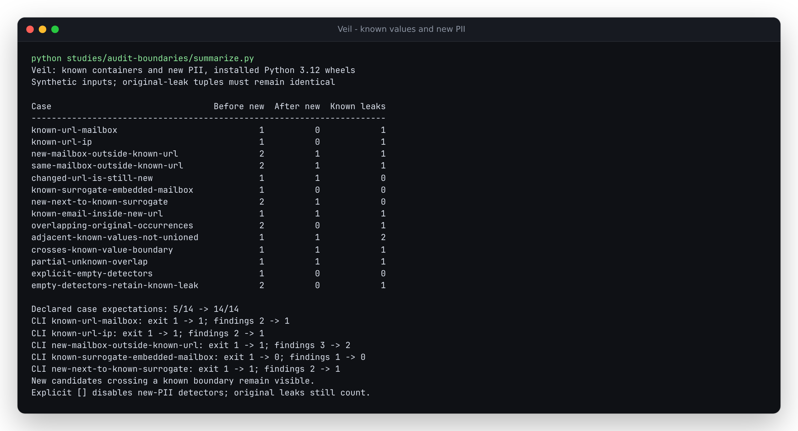

# A known whole value must not become newly introduced PII

Captured on 2026-10-15. All identities, URLs and caller-supplied surrogates in
this study are synthetic; no provider or external service is called.

Veil exposes two different audit questions. `find_leaked_originals` asks whether
an original reappeared verbatim. `find_new_pii` asks whether detectors found
something outside the known values. A restored reply intentionally contains its
originals, so callers can use the second check to look for additional PII.

At baseline `2157288edbcb7734f5edad80558c5546e02cc79a`, a whole credential URL
was correctly masked and restored, but its embedded mailbox or IP address then
appeared as **new** PII. Filtering only exact entity-value equality did not
recognize a detected fragment inside the already known URL. A caller-supplied
surrogate URL with a fake mailbox also made the full CLI audit fail, despite
containing no original or unknown value. Separately, `detectors=[]` silently
selected the default detectors instead of the caller's empty selection.

Implementation `1e0ebdc3a57ca50274526aef4aeba926eac5db43` corrects these
boundaries. All 14 authored contract cases now match their declared expectations,
where five matched before. This is a regression-case result, not a measured
PII-recall or model-accuracy estimate.



| Workflow | Before | After |
| --- | --- | --- |
| Restored known URL containing a mailbox/IP | One known leak plus one spurious new finding | One known leak; no new finding |
| Same mailbox appears outside its known URL | Both occurrences labelled new | The standalone occurrence remains new |
| Caller-supplied known surrogate contains a fake mailbox | CLI exit 1, one spurious finding | CLI exit 0, no findings |
| Unknown mailbox next to that surrogate | CLI exit 1, two findings | CLI exit 1, the unknown mailbox retained |
| A new credential URL contains a known email | New enclosing URL retained | New enclosing URL retained |
| Candidate crosses a known boundary or two adjacent known literals | New candidate retained | New candidate retained |
| `detectors=[]` | Default detectors run | No new-PII detectors run; original leaks still count |

## Public workflow and exact boundaries

With the corrected source installed:

```python
from veil import Masker
from veil.audit import audit, find_new_pii

original = "https://files.example.test/share?token=alice@example.com"
masker = Masker()
restored = masker.restore(masker.mask(original), tolerant=False)
assert restored == original
assert find_new_pii(restored, masker.vault) == []
assert [finding.kind for finding in audit(restored, masker.vault)] == ["leaked_original"]
```

The correction requires a candidate to be fully inside **one exact occurrence**
of an original or surrogate. Partial overlap is insufficient. Adjacent or
overlapping known spans are not merged to hide a larger unknown candidate.
All overlapping occurrences of each known literal establish containment;
the original-leak report retains its existing nonoverlapping repetition policy.
For example, knowing `aba` covers the suffix `ba` in `ababa` through the second
literal occurrence, even though that occurrence is not a second leak-report row.

The bounded prefix index from the [long-value audit study](../leak-audit/README.md)
locates these literals without interpreting escapes or normalizing spelling.
An interval index checks complete containment. Exact entity-value exclusions
remain, default detectors still run when the argument is omitted, and no
runtime dependency is added. `audit(..., detectors=[])` is an explicit
originals-only check; the CLI continues to use its default new-PII detectors.

## Evidence and reproduction

The replay uses public masking/restoration and audit APIs. Five cases invoke
the actual CLI; three also create their vault through `veil mask` and verify
`veil restore --exact`. Short caller-supplied literal detectors probe overlap
and boundary-crossing rules independently of built-in recognition heuristics.
The span index is also checked against pairwise interval containment.

- [Baseline installed-wheel replay](results/before-installed.json)
- [Corrected checkout replay](results/after.json)
- [Installed Python 3.10.21](results/installed-python310.json),
  [Python 3.12.12](results/installed-python312.json),
  [Python 3.14.7](results/installed-python314.json)
- [Captured terminal comparison](results/summary.txt)
- [Prior six performance workloads](results/performance.json)

Complete original-leak tuples remain identical in every before/after case.
The previous six performance workloads also retain their exact input and
finding hashes. Timings remain host-specific observations, not a claim that
the extra classification check is free.

```sh
uv run python studies/audit-boundaries/replay.py --output /tmp/veil-audit-boundaries.json --require-fixed
uv run python studies/audit-boundaries/summarize.py
uv run pytest tests/test_audit.py tests/test_spans.py
```

To reproduce the baseline, build/install a wheel from its pinned Git archive,
run the current replay with that environment's Python, and omit `--require-fixed`.
The [verification receipt](results/verification.json) records fresh archives,
locked installation, Ruff lint/format, strict mypy, **1,180 passing tests**, and
wheel/sdist builds. The optional spaCy module skips because its extra is absent.
Fresh dependency-free consumers on Python 3.10/3.12/3.14 replay all 14 cases and
the actual CLI. All 36 installed Python source files match the archived source.

The tested wheel is 98,688 bytes, SHA-256
`459300017b7a4fad9a290b82153018593fc7cc962ceefe8e7fd4a8279e6598a8`.
The existing `0.4.4` version is retained for local artifact checks. This is a
source correction, not a new PyPI release or manual hosted deployment.
