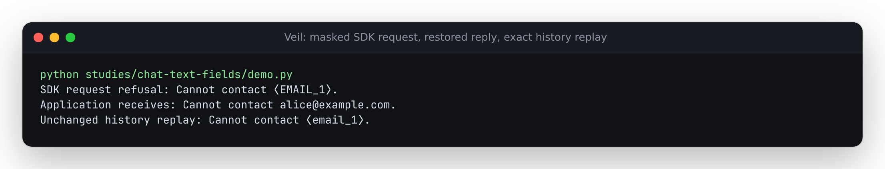

# Assistant history can carry private text outside `content`

At baseline `e417aa1`, the Chat Completions wrapper masked ordinary text and
modern function-tool arguments, but skipped other documented text fields.
The real OpenAI SDK 3.23.0 serialized raw synthetic email addresses into
request bodies when history put them in an assistant `refusal`, a refusal
content part, legacy `function_call.arguments`, or custom-tool `input`.
Complete replies also left surrogates in refusal, legacy and custom-tool
fields rather than restoring them.

The corrected source handles those input fields before transport, in sync
and async calls and both streaming entrypoints. Complete replies restore
their text and remember the original provider representation. Resending an
unchanged returned SDK message preserves that representation exactly,
including lowercase surrogates that were restored tolerantly. Edited history
is masked again rather than replaying an earlier response.

| Text location | Outgoing history | Complete response |
| --- | --- | --- |
| Message `refusal` | Mask detected string entities | Restore string |
| Content part with `type: refusal` | Mask its `refusal` text | Input representation only |
| Legacy `function_call.arguments` | Mask decoded JSON string values | Restore decoded values |
| Custom `tool_calls[].custom.input` | Mask plain text | Restore plain text |

Legacy JSON arguments use the same syntax-preserving path as modern
function tools. The captured argument document contains a 53-bit-exceeding
integer, duplicate members and whitespace; all unrelated bytes survive.
Custom-tool input is free-form text, not a JSON argument document.

## Reproduction through the real SDK

```bash
uv sync --locked --group dev
uv run python studies/chat-text-fields/replay.py --src src --out /tmp/chat-fields-after.json
```

To inspect baseline behavior without changing the checkout:

```bash
mkdir -p /tmp/claude-1000/veil-chat-fields-before
git archive e417aa1 src | tar -x -C /tmp/claude-1000/veil-chat-fields-before
uv run python studies/chat-text-fields/replay.py \
  --src /tmp/claude-1000/veil-chat-fields-before/src \
  --out /tmp/chat-fields-before.json --observe-only
```

[Before](results/before.json) and [after](results/after.json) preserve 54 SDK
workflows with the exact application input, mocked provider reply, returned
SDK message, request bodies and exception state. They comprise 24 outgoing
masking cases, 24 collision cases, and six complete-reply/replay cases.
Baseline sends raw contacts in all 24 outgoing masking cases and disagrees
with all 54 corrected expectations. The fixed source sends no raw contacts
in the recorded requests and has zero disagreements.

The collision cases put a literal placeholder in a newly covered field
after an earlier message would allocate that same placeholder. They now
reject before any request, retain the input and leave the vault empty. They
check a consequential ambiguity boundary, not just successful string replacement.
The regression suite also resends edited SDK messages and confirms that the
new contact is masked without mutating the original.

The [official Chat Completions schema](https://developers.openai.com/api/reference/resources/chat/subresources/completions/methods/create)
declares these input fields and complete-message outputs. The SDK is real;
the HTTP transport and every provider reply in this study are controlled
fixtures. No key, live model response or network API request is used.
The two email addresses are synthetic examples, not personal data. This
study establishes handling of these protocol fields, not general detector
accuracy or production server behavior.

## Boundaries

The correction is unreleased. It covers outgoing messages through
`OpenAIVeil` / `AsyncOpenAIVeil`, and complete Chat Completions responses.
Existing streaming output restoration handles ordinary text, refusals and
modern function-tool arguments; this change does not add streaming custom
or deprecated function-call output restoration. It does mask these history
fields before a streamed request.

Unchanged retained provider output deliberately replays exactly, so text
already produced by the provider is not treated as new application input.
Edited or newly supplied text is scanned by the configured detectors.
Binary content, references, metadata, and numeric values are outside this
text-field change. JSON keys containing detected sensitive values reject
legacy arguments just as they reject modern function arguments.
The name of a tool or function is not renamed. Existing replay-cache capacity
and ambiguity limits still apply.

## Clean and installed verification

A fresh archive of implementation commit `db481cc` passed a locked install
including the optional spaCy backend, lint, formatting, strict mypy and all
666 tests with no skips. Wheel and source-distribution builds passed. The
web install, typecheck/build and 16 existing Chromium/Firefox scenarios
also passed, including offline reuse and mobile layouts. Browser scenarios
exercise the core Python demo, not these optional SDK wrappers.

| Installed wheel environment | SDK workflows | Additional regression cases |
| --- | --- | --- |
| Python 3.14.7, OpenAI 3.23.0 | 54 pass; zero raw-contact request bodies | 24 pass |
| Python 3.10.21, OpenAI 1.66.0 | 54 pass; zero raw-contact request bodies | 24 pass |
| Python 3.12.12, core wheel only | SDK absent | Documented masking/restoration example passes |

[Current](results/installed-current.json) and [floor](results/installed-floor.json)
captures use the installed wheel with `PYTHONPATH` cleared. The replay verifies
that product imports come from `site-packages`. Older SDKs represent newer
custom-tool fields as extra protocol data; this verifies their local
serialization/transformation, not server acceptance of an older SDK's schema.

The [receipt](results/verification.json) records commands, artifact hashes,
versions and limits. All 34 runtime Python files match the clean source in
the wheel, three installations and built browser manifest. The locally built
wheel is 90,029 bytes with SHA-256
`47766b7ade89117930bb30b99f1674791c072d76ce88337ed5e2e2a14c1a19c1`.
The package version remains unchanged; no package was published and no demo
was deployed. `cd web && npm run build` produces `web/dist/`.



[The demo](demo.py) prints actual captured fields from the local SDK transport.
The image was rendered from its [unedited stdout](../../docs/assets/chat-text-fields.ansi)
using the installed current wheel, then visually inspected. Its API key is a
dummy literal used only by the mock transport.
