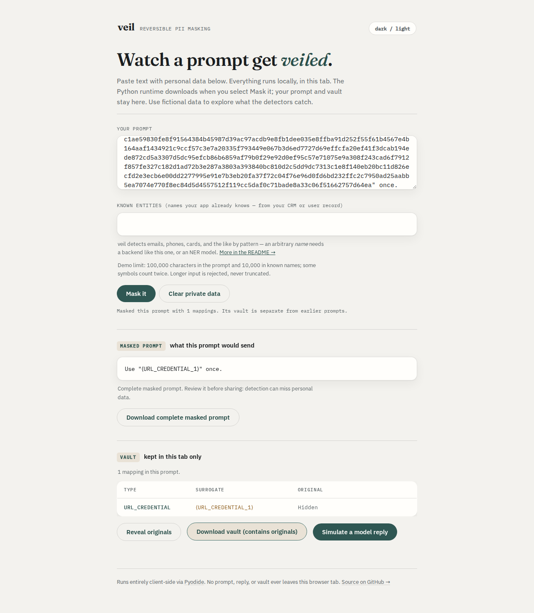

# Credential URLs must be masked as a whole

At baseline `030c69ba8b9a54785ec8a0ccefc609124bdfb788`, the default `Masker`
leaves a Google Cloud Storage V4 signed URL unchanged. Other cloud signed links
can have only an access-key identifier or a piece of their signature masked.
OAuth redirects with `#access_token=...` and query keys such as
`access%5Ftoken` also pass through unchanged. Restoring unchanged text succeeds,
so a round-trip check alone would miss these leaks.

The fix recognizes credential parameter names in queries and fragments while
retaining the complete original URL as one vault entry. It adds no runtime
dependency. This is source work; the registry package and hosted demo are not
updated by these commits.

## Recognition rules

Names are case-insensitive and percent-decoded once after splitting fields on
`&` and the first `=`. Values are not decoded or rewritten. Each listed field
must have a nonempty value. Duplicate names with any nonempty value count.
Companion fields must occur in the same component, not on opposite sides of
`#`. Custom domains work because recognition uses fields rather than hostnames.

| Shape | Recognized fields |
|---|---|
| Existing sensitive-token names | `api_key`, `access_token`, `auth_token`, `token`, `secret`, `password`, `session_id`; existing optional hyphen/underscore variants |
| AWS Signature V4 | `X-Amz-Signature` |
| GCS Signature V4 | `X-Goog-Signature` |
| Azure Storage SAS | `sig` together with `sv` |
| AWS/GCS V2 | `Signature` together with `AWSAccessKeyId` or `GoogleAccessId` |
| CloudFront | `Signature` together with `Key-Pair-Id` |

Query fields, OAuth-style fragments, and router fragments such as
`#/callback?access_token=...` are inspected. Existing userinfo and raw-token
matches remain supported. URL boundary and trailing-punctuation behavior are
unchanged. A generic `?signature=short-value` or `?sig=short-value` does not
match the new rules. Encoded separators inside a value do not invent fields;
double-encoded names are not recursively decoded.

These are recognition heuristics, not signature validation. Unknown credential
names, non-URL SAS strings, encoded URLs embedded inside values, and other
access-link schemes remain outside these additions. Other detectors can still
mask an ordinary URL's address or high-entropy text. No claim is made that all
credentials are found or that every matching URL actually grants access.

## Independent format evidence

[`generate.py`](generate.py) uses the real Google Cloud Storage, Azure Blob
Storage and Boto3/Botocore SDKs to generate nine signed-link fixtures. They
cover GCS V4/V2, S3 V4/V2, Azure blob/account/stored-policy SAS, and CloudFront
canned/custom policies. All identities and keys are synthetic. RSA keys exist
only in memory and are discarded; socket connections and DNS resolution are
blocked during generation. Nothing is authenticated against a cloud service.

[`cases.json`](cases.json) retains those exact URLs, SDK versions and 30
handwritten syntax controls. The signing clock is fixed; a fresh RSA key means
regeneration changes RSA signatures. Replay uses the retained fixture bytes.
SDK dependencies in [`requirements.txt`](requirements.txt) are only for fixture
generation, not Veil installation.

The matching fields agree with the providers' specifications:

- [AWS query authentication](https://docs.aws.amazon.com/AmazonS3/latest/developerguide/sigv4-query-string-auth.html)
  describes `X-Amz-Signature`.
- [GCS signed URLs](https://docs.cloud.google.com/storage/docs/access-control/signed-urls)
  and [V2 signing](https://docs.cloud.google.com/storage/docs/access-control/signed-urls-v2)
  describe the V4 signature and V2 signer/signature fields.
- [Azure service SAS](https://learn.microsoft.com/en-us/rest/api/storageservices/create-service-sas)
  and [account SAS](https://learn.microsoft.com/en-us/rest/api/storageservices/constructing-an-account-sas)
  describe the signed version and signature fields.
- [CloudFront signed URLs](https://docs.aws.amazon.com/AmazonCloudFront/latest/DeveloperGuide/private-content-creating-signed-url-canned-policy.html)
  pair the signature with a key-pair identifier and allow custom domains.
- [OAuth 2.0, section 4.2.2](https://www.rfc-editor.org/rfc/rfc6749.html#section-4.2.2)
  specifies an access token in the redirect fragment using form encoding.

## Before and after

[`replay.py`](replay.py) runs the actual default masker, URL detector, CLI
stdin/stdout and saved vaults. Exact and tolerant restoration must preserve
the original text; streaming restoration is checked at four chunk sizes.
Optional SDK checks capture actual OpenAI Chat Completions, OpenAI Responses
and Anthropic Messages request bodies through local echo transports. No
provider request is sent.

| Observed result | Baseline | Corrected source |
|---|---:|---:|
| Complete credential URL masked | 6 / 24 | 24 / 24 |
| SDK-generated signed URL masked whole | 0 / 9 | 9 / 9 |
| Ordinary-link controls unchanged | 15 / 15 | 15 / 15 |
| CLI result and complete vault entry match expectation | 21 / 39 | 39 / 39 |
| SDK request body matches expectation | 63 / 117 | 117 / 117 |
| Library and CLI restoration preserve source | 39 / 39 | 39 / 39 |

The [before](before.json) and [after](after.json) receipts include per-case
spans, whole-URL expectations, hashes, CLI outcomes and transport captures.
Ten of the 24 credential inputs pass through entirely unchanged at baseline;
eight more are only partially masked. These selected fixtures demonstrate
specific gaps, not recall on real issued credentials or model behavior.

## Browser and installed wheel

The [baseline browser receipt](browser-before.json) records 84/156 expected
results; the [corrected receipt](browser-after.json) records 156/156. Each run
checks all 39 inputs in Chromium and Firefox at 375 and 1280 pixels, with 312
actual masked-text/vault downloads. After runtime initialization, all cases
run offline with zero additional requests. There are no page errors, CSP
violations or horizontal page overflow. All ten served application assets
match the tested build, and its 34 Python files match the source checkout.
The [existing browser suite](browser-existing.json) also passes 16 scenarios
covering keyboard use, both themes, accessibility, isolation and recovery.



Compare the [baseline desktop](../../docs/assets/credential-urls/before/chromium-1280.png)
and [corrected phone](../../docs/assets/credential-urls/after/chromium-375.png)
captures. All eight screenshots were opened and inspected. The synthetic
GCS URL is visible in the baseline output and replaced as a whole after the
fix. The browser's canned reply does not echo URLs; exact restoration is
verified through the library, CLI, streaming restorer and SDK echo captures.

The [verification receipt](verification.json) covers a clean archive of
production commit `7168237815648a5935efbf16e7c4e5ccccaeefe0`. Locked installs
pass lint, formatting, mypy and 537 tests on both Python 3.10.21 and 3.14.7;
the optional spaCy check is skipped in each. The sdist and wheel build, and
the existing 60-document synthetic detector smoke check passes. Scratch
virtual-environment directories were excluded from lint/format input.

The wheel installs separately on Python 3.10 with **no other distributions**
and passes all 39 CLI/library cases. A Python 3.14 installation with the real
OpenAI and Anthropic SDKs also passes all 117 transport checks. Case records
match the source replay exactly. See [core installation](installed-core310.json)
and [SDK installation](installed-sdk314.json). All 39 retained wheel files
(excluding the installer-rewritten `RECORD`) match both installations. All
35 source package files, including `py.typed`, match the tested archive.

The wheel is 87,234 bytes with SHA-256
`e5508172be4d18c1d46019f0c7acddcfc33e76ecddd9117d75ec9e2fd024a7e4`.
It retains version 0.4.4 and is a local artifact, not a registry release.
The static build command is `npm run build --prefix web`, producing `web/dist`;
this work does not deploy that build.

## Compatibility and cost

The [public-text receipt](corpus.json) compares all resolved entities on the
earlier study's 1,483 hash-checked technical files: 32,925,796 bytes,
2,616,034 words and 10,339 detections. Types, spans, detector names, confidence
and values are unchanged for every file. The corpus does not establish
false-positive rates for signed URLs, which it was not designed to contain.

[`scaling.py`](scaling.py) measures the URL detector alone on synthetic ordinary
parameter lists, using five repetitions at each size. On this 14-vCPU WSL2
Linux host with 48 GB RAM, the corrected detector takes about 29 ms for
917,529 characters of plain parameters and 117 ms for 1,048,601 characters of
encoded names. The baseline takes about 8 and 9 ms respectively. Added parsing
has a measurable cost; observed growth is roughly linear. These are local
samples, not full-mask throughput guarantees. See [before](scaling-before.json)
and [after](scaling-after.json) timings.

## Reproduce

From the repository root, with the dev environment installed:

```sh
uv run python studies/credential-urls/replay.py --source . --sdk --output /tmp/urls-after.json
uv run pytest tests/test_credential_urls.py tests/test_detectors_url.py
PYTHONPATH=src uv run python studies/credential-urls/scaling.py /tmp/urls-scaling.json
```

Pass `--source /path/to/baseline --baseline` to the replay for the old source.
Omit `--source` when using a Python environment with a separately installed
wheel. Omit `--sdk` to verify the dependency-free core and CLI.

Browser replay uses the production UI and real Python in Chromium and Firefox
at 375 and 1280 pixels. After loading Pyodide it switches offline, checks each
prompt and both downloads, and compares served application bytes with the
build. It paces export clicks to stay below Chromium's download rate limit.

```sh
npm ci --prefix web
npm run build --prefix web
node studies/credential-urls/browser.mjs web /tmp/urls-browser
```

To regenerate the synthetic cloud examples in a separate environment:

```sh
uv venv /tmp/veil-url-sdks
uv pip install --python /tmp/veil-url-sdks -r studies/credential-urls/requirements.txt
/tmp/veil-url-sdks/bin/python studies/credential-urls/generate.py
```
