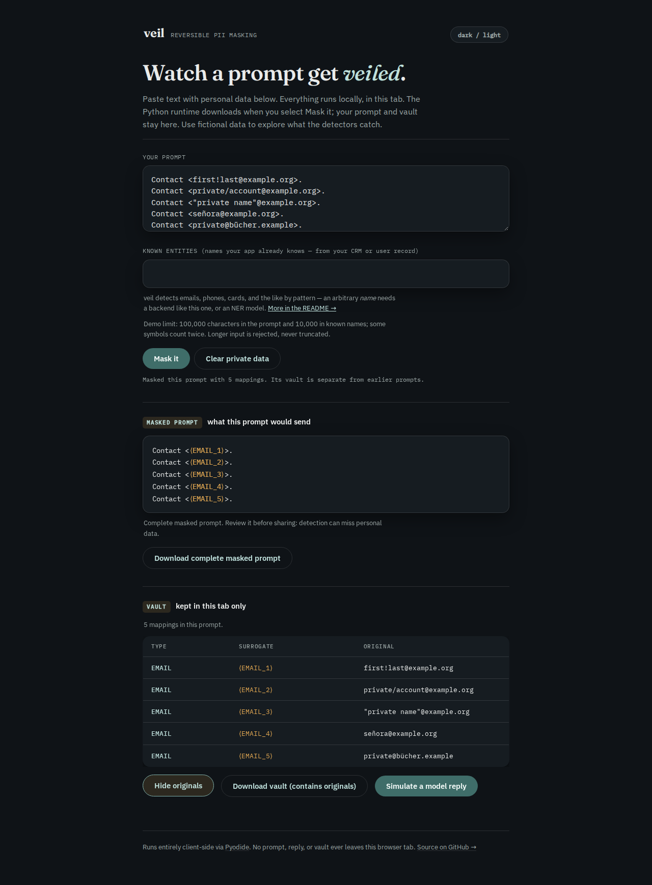
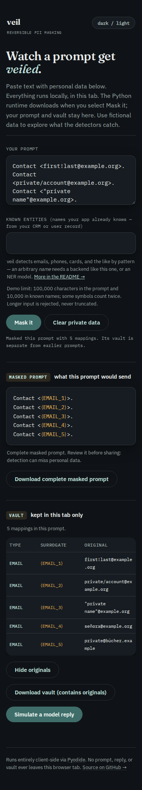

# Whole mailbox identities before transport

At baseline `d3f43e0`, `first!last@example.org` became
`first!⟨EMAIL_1⟩`: a valid local-part prefix still reached the SDK transport.
Slash and equal characters had the same partial-match problem. Valid quoted
and internationalized addresses, punycode TLDs and TLDs longer than the old
24-character cap could pass through completely.

The [before capture](results/before.json) and [corrected capture](results/after.json)
use actual installed OpenAI and Anthropic SDKs over an HTTP mock transport.
Only synthetic replies and mailboxes are used, and no provider is contacted.
The 24 fixtures produce 288 requests each: Chat Completions, Responses and
Anthropic Messages, sync and async, complete and character-at-a-time streamed
replies. CLI masking, persisted vault reload, exact restoration and four
additional streaming chunk sizes are checked for each fixture.

The separate [tool-argument capture](tool-arguments.py) checks seven difficult
addresses in all three APIs. At baseline none of the 21 tool inputs is fully
masked; both installed wheels mask all 21. Anthropic dictionary inputs restore
exactly, and Chat/Responses JSON strings keep original whitespace, escapes,
duplicate keys and the arbitrary-precision integer spelling.

| Fixture outcomes | Baseline | Corrected source |
| --- | ---: | ---: |
| Complete masks of supported mailbox fixtures | 3 / 19 | 19 / 19 |
| Invalid/local-only controls left alone | 5 / 5 | 5 / 5 |
| SDK requests matching the expected masking boundary | 96 / 288 | 288 / 288 |
| Echoed replies restored byte-for-byte | 288 / 288 | 288 / 288 |

The ASCII punctuation fixtures are independently accepted by Python's
`email.headerregistry.Address`, rather than deriving the expected syntax from
Veil. The grammar comes from [RFC 5322 sections 3.2.3 and 3.4.1](https://www.rfc-editor.org/rfc/rfc5322.html#section-3.2.3),
the UTF-8 extension from [RFC 6531 section 3.3](https://www.rfc-editor.org/rfc/rfc6531.html#section-3.3),
and octet limits from [RFC 5321 section 4.5.3.1](https://www.rfc-editor.org/rfc/rfc5321.html#section-4.5.3.1).
These establish syntax and limits, not that the example addresses receive mail.

## What changed

The detector scans bounded candidates around each `@`, retaining exact source
spans. It accepts the full ASCII dot-atom punctuation set and international
local parts made of letters, marks and numbers. Quoted local parts retain spaces,
escapes and internal `@` characters as part of a single identity. A preceding
invalid/overlong atom cannot produce a suffix match. Empty quote/backtick
delimiters around code decorators remain non-mailboxes.

Domain labels receive a structural check using Python's standard-library IDNA
codec, with 63-byte labels and a 253-byte ASCII domain. Existing punycode labels
must decode. Original spelling, normalization and case never change in the
vault: the codec is not used to rewrite the text. The local part is limited to
64 UTF-8 bytes including its quoting syntax.

This remains a pragmatic prose detector. It requires a dotted domain and an
alphabetic or punycode final label. It does not implement comments, folded
whitespace, domain/address literals, local-only domains, or unquoted Unicode
symbol/control local parts. It does not claim full IDNA 2008 validation or check
DNS, a public suffix list, mailbox existence or provider acceptance.

## Retained text, reviewed again

The [corpus replay](corpus.py) verifies every cached input's recorded SHA-256
against the four manifests in `../real-text/`, then uses the existing tag
rendering, sampling and full-span coverage rules. This is a recheck of the
2026-10-01 snapshot, not a new scrape or a new held-out evaluation. Development
and the previously held-out split were both inspected while making this change.
Receipts publish offsets/hashes/counts rather than contact values.

| Split | Email tags | Fully covered before | Fully covered after |
| --- | ---: | ---: | ---: |
| Original development contact sample | 5,019 | 5,011 | 5,014 |
| Previously held-out contact sample | 5,561 | 5,549 | 5,554 |

Eight more tags are fully covered: punctuation in two local parts,
international letters in three local parts and three Unicode domains. Twelve
tags still do not receive a full email mask; these include multi-address tag
values, spaces, invisible characters and malformed entries. An `@` in a tag
does not establish that its contents are a valid address.

The [installed core-only detector-pool check](results/installed-core-contact-pool.json)
also runs `Masker.find_entities` with all default detectors on these same tags.
Its coverage agrees with the standalone email detector: these extra identities
remain fully masked after overlap resolution in the actual product pipeline.

The 2,616,034-word technical corpus was also rechecked. Manual review of every
changed detection found 27 newly covered quoted mailbox occurrences and seven
newly matching source templates. Fourteen existing detections expand to include
adjacent slash or assignment syntax; all their original spans remain covered.
No new decorator matches remain. The [review receipt](results/corpus-review.json)
records every changed file/span/hash and classification.

Syntactically valid punctuation creates unavoidable prose ambiguity:
`email=private@example.org` may be a mailbox local part containing `=` or an
assignment. `${GITHUB_ACTOR}@users.noreply.github.com` has mailbox syntax while
being a source template. Surrounding syntax can therefore be masked with the
identity. Restoration preserves the exact source text, but masked text need
not remain executable code. The seven template matches are extra detections,
not new contacts or evidence of perfect precision.

Two existing contact spellings caught during review are retained explicitly:
`mailto:@private@example.org` and Calendar account logs using
`private@example.org@https://calendar.example.org/...`. A marker before the
mailbox or a URL after it does not remove the recorded contact.

The constructed-input [timing receipt](results/timing-after.json) keeps the
cost of the added syntax visible. On the recorded 14-vCPU WSL2/48-GB host,
10,000 mailbox occurrences take a median 72 ms, versus 32 ms for the old
partial-match regex. Repetitive 200-KB invalid inputs remain bounded: 0.1 ms
for a long atom, 0.2 ms for escaped quotes and 50 ms for many `@` characters.
These are five-run medians for this host, not general performance guarantees.

## Reproduce

```sh
uv sync --locked --group dev
uv run --no-sync python studies/email-boundaries/replay.py --output /tmp/email-after.json --require-fixed
uv run --no-sync python studies/email-boundaries/benchmark.py --output /tmp/email-timing.json
```

To reproduce the baseline without changing this checkout, export `src/` from
`d3f43e0` into a scratch directory and set `PYTHONPATH` to that source directory
when running the same scripts, omitting `--require-fixed`. The receipt records
the loaded email detector's source hash. SDK versions are recorded separately
from Veil's package version, which has not been bumped for this local change.

`corpus.py` additionally requires the ignored prior raw corpus. Pass
`--output studies/email-boundaries/results/corpus-after.json` and
`--details studies/email-boundaries/cache/corpus-after.json`, then run
`review-corpus.py` against the retained before receipt. The raw technical
sources keep their original licenses; the retained OSM data is under ODbL 1.0,
copyright OpenStreetMap contributors, as recorded in the original manifests.

For the browser demo, `cd web && npm ci && npm run build` produces `web/dist/`.
Run `node studies/email-boundaries/check-browser.mjs` from the repository root.
The script loads Pyodide online with a neutral prompt, disconnects before the
first mailbox operation, then checks the actual Python, masked-text and vault
downloads, exact restoration, simulated streamed replies and responsive layout
in Chromium and Firefox at 375px and 1280px. No model is called.

This is a local source correction. It has no corresponding registry release
or verified hosted deployment.

## Installed artifact verification

Code commit `06ca417` was exported into a fresh directory. Python 3.14.7 passed
lint, format, type checks and 952 tests, with the optional spaCy backend installed
and no skips. `uv build` built the wheel from its source distribution. The
[verification receipt](results/verification.json) records artifact hashes,
all runtime file hashes, checks and the retained command output in
[`results/logs/`](results/logs/). Temporary/user-home paths in logs are replaced
with placeholders; other output is unchanged.

| Separate wheel installation | Actual SDK capture | Additional checks |
| --- | --- | --- |
| Python 3.14.7, OpenAI 3.31.0, Anthropic 1.14.0 | [288 text/stream requests](results/installed-current.json), [21 tool requests](results/tool-installed-current.json) | 217 mailbox/SDK/JSON/collision regressions passed |
| Python 3.10.21, OpenAI 1.66.0, Anthropic 0.40.0 | [288 text/stream requests](results/installed-floor.json), [21 tool requests](results/tool-installed-floor.json) | 942 passed; 8 explicit optional-backend/older-SDK shape skips |
| Python 3.12.12, core wheel only | No SDK dependency installed | All 24 core cases, character streaming and the actual `veil mask`/`veil restore` console pair passed |

Source, current SDKs and the explicitly pinned SDK floors produce identical
captured cases and request bodies. All 35 runtime files match working source,
clean archive, sdist, wheel and each of the three installations. The browser
manifest matches all 34 Python files; actual received assets match the served
clean build. Run [the artifact verifier](verify-artifacts.py) with `--help` for
its required existing-artifact paths; it makes no install or network request.
The package metadata remains `0.4.4`: these are local builds of the corrected
source, not a claim that PyPI's existing release contains this change.

The clean browser build passed all 16 existing demo scenarios plus the four
new offline mailbox workflows in the [browser receipt](results/browser/receipt.json).
The downloaded text and vault are retained alongside that receipt. All four
screenshots were inspected: the page stays within the viewport at 375px and
desktop sizes, and long mailbox values wrap inside the vault. The short native
textarea can scroll to display the rest of the input.





The build command remains `cd web && npm ci && npm run build`, producing
`web/dist/`. Suggested repository description (unchanged scope):
"Reversible PII masking for LLM calls, with exact streaming restoration and inspectable privacy boundaries."
Topics: `pii`, `privacy`, `llm`, `pseudonymization`, `redaction`, `streaming`, `python`.

## Public source verification

The corrected source and retained evidence were pushed to `main` at
`dc73da7cce216217a8bb7006ea194dd6923a05de` after installation and browser checks.
All 53 changed files match pinned GitHub raw-file bytes from a clean local
checkout. The [public-source receipt](results/public-source.json) records their
sizes and SHA-256 hashes. This updates Git source; it does not publish a PyPI
release or deploy the hosted browser demo. The earlier local artifact records
retain their original verification boundary.
