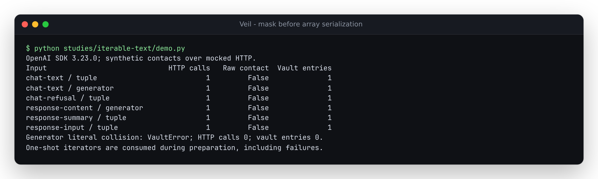

# Array serialization happened after inline text masking

At baseline `245e63e`, OpenAI's actual Python SDK serialized tuple and generator
content parts as JSON arrays, while Veil visited only lists. A user message
with `content=({"type": "text", "text": "Contact alice@example.org."},)`
reached transport with the raw synthetic address. Replacing the tuple with
the equivalent list masked it. Refusal parts, Responses message/tool-output
parts and reasoning summaries had the same shape-dependent gap. A tuple of
Responses input items bypassed the entire input traversal.

The actual SDK declarations for Chat content use Python `Iterable`; the
[Chat API reference](https://developers.openai.com/api/reference/resources/chat/subresources/completions/methods/create)
and [Responses API reference](https://developers.openai.com/api/reference/resources/responses/methods/create)
describe their wire content. This study records what SDK 3.23.0 really sends,
using controlled HTTP replies. It does not infer live API acceptance from
serialization, or treat the narrower Responses `List` annotation as a privacy
check. The contacts, images and replies are synthetic.

| Input boundary | Baseline | Corrected preparation |
| --- | --- | --- |
| Chat text/refusal content tuple or generator | Raw contact in emitted array | Visit and mask every recognized inline text part |
| Responses tuple input | Raw contact in emitted array | Visit each input item, including retained provider history |
| Responses content/tool-output tuple or generator | Raw contact in emitted array | Visit recognized text parts |
| Reasoning summary tuple or generator | Raw contact in emitted summary | Mask summary text; keep encrypted content unchanged |
| Responses top-level generator | SDK serialization error before transport | Materialize safely before SDK serialization; newly supported lowering |
| Equivalent lists | Masked normally | Unchanged |

The source correction materializes iterable array fields during preparation,
without treating a mapping or binary object as an array. It copies block
containers and keeps image references and encrypted reasoning exactly as
provided. It does not add masking of opaque fields or unknown future items.
One-shot iterators are consumed once. If iteration raises or a literal
surrogate collides with an earlier replacement, no HTTP call occurs and vault
changes roll back; the iterator itself cannot be rewound.

## Reproduce

```sh
uv sync --locked --group dev
uv run --no-sync python studies/iterable-text/replay.py --src src --out /tmp/iterable-text.json
```

Export `245e63e` into another directory to inspect the baseline without changing
this checkout. Pass its `src/` to the same replay and add `--observe-only`.
The script verifies the imported product path, records both runtime source
hashes and retains actual SDK request bodies. It builds each generator afresh;
original blocks and reusable list/tuple inputs are checked for mutation.

The [before corpus](results/before.json) has 84 contract disagreements across
126 workflows, with raw contacts in 68 request cases. The
[corrected corpus](results/after.json) has zero of each. Six boundaries are
checked as lists, tuples and generators through complete, raw create-stream
and wrapper-stream calls, synchronously and asynchronously. Eighteen additional
literal-collision cases check preparation rollback. The top-level generator
controls that the baseline SDK rejected are labelled as newly supported input;
they are not counted as previous transport leaks.

The regression suite also checks failure midway through a one-shot iterator
and exact replay of real returned SDK items inside tuple/generator histories,
including the provider's lowercase surrogate spelling. All transports are
mocked. There are no live inference, token-usage or production-privacy claims.

## Installed artifact verification

The [verification receipt](results/verification.json) identifies code commit
`1906438`, artifact hashes, all matched runtime files and retained check logs.
A fresh archived checkout passed lint, format, type checks, 837 Python tests
with spaCy included and no skips, package/web builds and all 16 existing
Chromium/Firefox demo scenarios, including offline reuse.

| Installed environment | Captured transport workflows | Additional regressions |
| --- | --- | --- |
| Python 3.14.7 / OpenAI 3.23.0 | [126; zero disagreements or raw-contact cases](results/installed-current.json) | 136 passed |
| Python 3.10.21 / OpenAI 1.66.0 | [126; zero disagreements or raw-contact cases](results/installed-floor.json) | 136 passed |
| Python 3.12.12 / core wheel only | Documented mask/restore example passed; optional SDKs absent | Not an SDK run |

All 34 runtime files match the tested source, wheel, source archive, three
installations and browser manifest. All 36 ordinary list request controls have
the same captured JSON bodies before and after this repair. The
[terminal output](../../docs/assets/iterable-text.ansi) was captured unedited
from `python studies/iterable-text/demo.py` against the installed current wheel.



This source correction has no corresponding registry release or verified hosted
deployment. Build the local package with `uv build`; the existing browser demo
build is `cd web && npm run build`, producing `web/dist/`.
