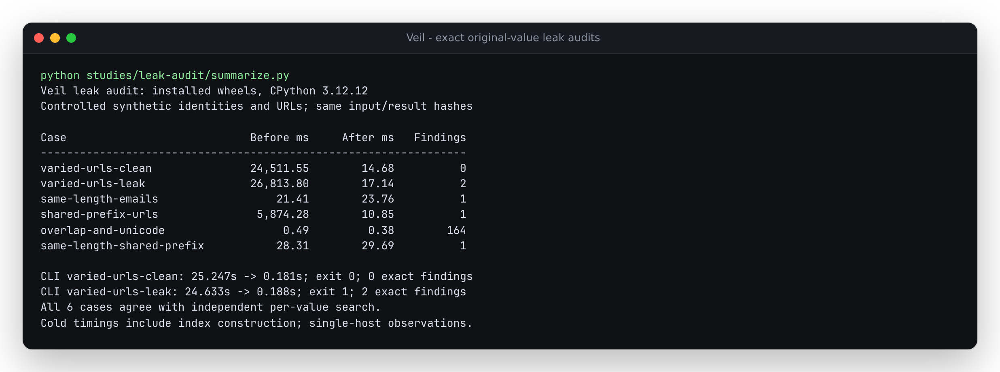

# Long vault values must not make a small leak audit take seconds

Captured on 2026-10-15, on x64 WSL2 Linux 6.18.54.1, 14 logical CPUs and
approximately 47 GiB RAM. These are controlled synthetic inputs, not captured
customer traffic or a measurement of provider latency.

`find_leaked_originals` checks outgoing text against the exact values already
known to a vault. Before this correction, every character starting a possible
original triggered a substring copy and hash for **every stored value length**.
A vault containing long credential URLs of varied lengths made this ordinary
benign-text path expensive even when none of their URL prefixes appeared.

For 3,000 synthetic credential URLs and 178,000 characters of repeated benign
prose, the installed baseline needed **24.512 seconds** for its cold library
check. The corrected installed wheel needed **0.015 seconds**. The complete
`veil audit --json` process, including vault loading, the other PII detectors
and JSON output, changed from **25.247 to 0.181 seconds** and still exited 0.
Appending two known originals still produced exactly two findings and exit 1.



## Exact comparisons and controls

Baseline implementation: `e0eff010da46de9aff6c143802a3de65edb389bd`.
Corrected implementation: `be9f8d23d65af0c807beeb07eae90657b79a7bc6`.
Both primary comparison wheels ran in fresh, dependency-free CPython 3.12.12
environments. Timings below include building each vault's lookup index.

| Controlled input | Mappings | Characters | Before, ms | After, ms | Findings |
| --- | ---: | ---: | ---: | ---: | ---: |
| Varied-length URLs, clean prose | 3,000 | 178,000 | 24,511.55 | 14.68 | 0 |
| Same prose with two leaked URLs | 3,000 | 181,133 | 26,813.80 | 17.14 | 2 |
| Equal-length emails | 10,000 | 178,031 | 21.41 | 23.76 | 1 |
| Varied URLs sharing a long prefix | 1,000 | 179,644 | 5,874.28 | 10.85 | 1 |
| Nested originals and Unicode | 8 | 162 | 0.49 | 0.38 | 164 |
| Equal-length URLs sharing one prefix | 1,000 | 560,075 | 28.31 | 29.69 | 1 |

The ordinary email and equal-length URL controls remain on the same millisecond
scale; this change does not establish a speed improvement for every vault.
These are single cold/warm observations on this host, without CPU affinity,
not latency percentiles or a general performance guarantee. Compare the raw
records before drawing conclusions from small differences.

The replay masks URL/email inputs through the public `Masker` API, verifies
restoration, and calls the public audit function. Its independent oracle uses
native `str.find` separately for each mapping. It compares full ordered tuples
of entity type, original value, start and end, including:

- Multiple entity types with the same original, in vault order.
- Different originals whose occurrences overlap, and the established
  nonoverlap rule for repetitions of one original.
- Lengths around the 32-character boundary, Unicode text and character offsets.
- A candidate that shares a stored prefix but is not a stored original.
- Additions after an index is cached and rollback of a failed vault transaction.

Receipt hashes cover complete finding tuples, not only counts. The clean/leaky
CLI checks also compare complete JSON findings and require exit 0/1 respectively.
No network request or model call is involved; URLs use the reserved `.test`
domain and synthetic tokens.

- [Baseline wheel replay](results/before.json)
- [Additional baseline equal-length prefix control](results/prefix-control-before.json)
- [Corrected checkout replay](results/after.json)
- [Installed Python 3.10.21](results/installed-python310.json),
  [Python 3.12.12](results/installed-python312.json),
  [Python 3.14.7](results/installed-python314.json)
- [Verified terminal output](results/summary.txt)

## Implementation and limits

The cached index first groups originals by at most 32 characters. Candidate
lookup therefore uses at most 32 prefix lengths at a starting character,
independent of how many full lengths the vault holds. A prefix match alone
never creates a finding. A single candidate is checked with `str.startswith`,
without copying its full value. Candidates sharing both a prefix and a length
use one full substring hash lookup, rather than one comparison per original.
The latter matters for URLs sharing a host/path or secrets sharing a header.

Matching remains exact, case-sensitive and literal. Neither Unicode
normalization nor JSON escape interpretation is added. Prefix collisions can
still require work for several full lengths, and returning many actual
occurrences costs time and memory. This is not a claim of universal linear
runtime. The index is derived from vault mappings, is invalidated on additions,
and follows transaction rollback. It introduces no runtime dependency.

This changes original-value lookup, not detector recall, SDK transport handling,
or the semantics of new-PII detection. Restoring a reply intentionally puts its
originals back; an original-value audit after restoration will flag them by
design.

## Reproduce and installation checks

From the current checkout with its development environment installed:

```sh
uv run python studies/leak-audit/replay.py --output /tmp/veil-audit-current.json
uv run pytest tests/test_audit.py
uv run python studies/leak-audit/summarize.py
```

For the baseline, archive the pinned baseline commit into a separate directory,
build a wheel there, and install it into a fresh Python 3.12 environment. Run
the **current** replay script with that environment's Python. The full replay
includes all six cases; `--prefix-control-only` selects the separately retained
baseline control. The original five-case baseline was captured before adding
that control. Its input/result hashes are checked against the corrected replay.

The [verification receipt](results/verification.json) records a fresh Git
archive of the corrected implementation, locked installation, Ruff checks and
formatting, strict mypy, the complete test suite and wheel/sdist builds.
**1,169 tests passed**; one optional spaCy test module was skipped because that
extra was not installed. Fresh consumers on Python 3.10, 3.12 and 3.14 installed
only the built core wheel, then completed the replay and CLI checks. All 36
installed Python source files matched the archived source byte for byte.

The tested wheel is 97,938 bytes, SHA-256
`d7da2efa5e6780f8192764eb2faf129fde3016d2b13113e3d03896a4a10d116f`.
It retains the existing `0.4.4` version for local installation verification.
This is a source correction, not a new PyPI release or hosted browser deployment.
