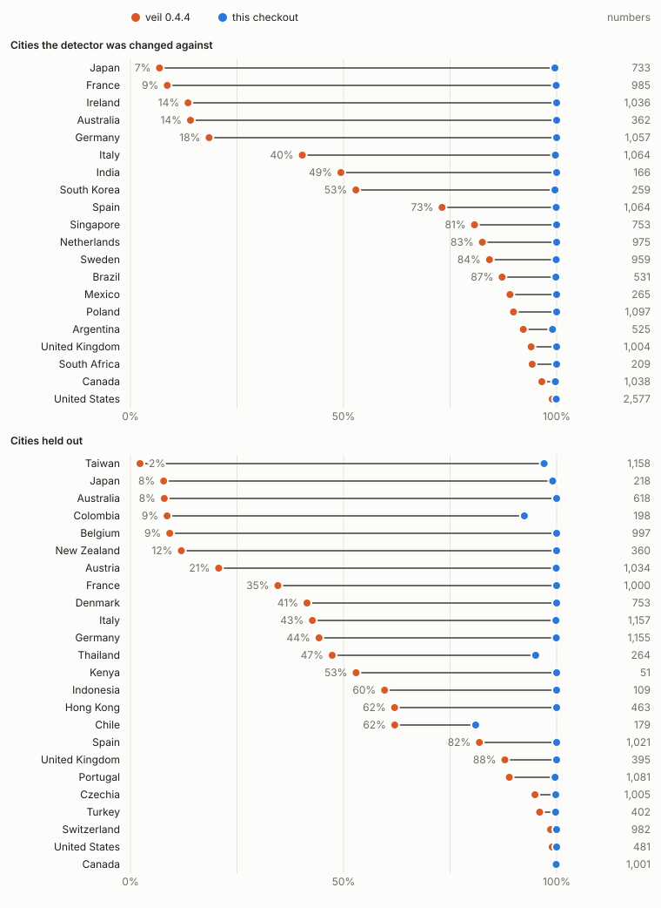

# veil on text nobody wrote for it

veil's measured results were a perfect score, on 240 documents that its own
generator wrote, and "0.00 benign false positives per 1,000 words" on 80 more
of them. The README said what that was worth: "synthetic benchmarks overstate
real-world performance". This study finds out by how much.

Two kinds of real text, each with an answer that veil had no part in:

- **Contact details as people type them.** 32,115 places from OpenStreetMap in
  46 cities of 35 countries, each carrying a phone number or an email address
  that a mapper or the owner entered by hand. The tag key says which value is
  which, so nobody had to label anything.
- **Text with almost nothing in it to mask.** 2.6 million words of system
  logs, CI build logs and source code: what a masking proxy in front of a
  coding agent reads all day. Whatever veil calls a card number in a Hadoop log
  is not one.

**What came out**

- **A third of the phone numbers written with a `+` went through unmasked.**
  The released 0.4.4 masked 66.2% of 16,659 of them: 99% in the United States,
  9% in France, 7% in Japan. Its pattern allowed groups of two to four digits,
  and France writes `+33 1 …`, Germany `+49 30 12345678`. It now reads the
  calling code and checks the length that country uses: 99.9%. On 24 cities
  collected after the change it finds 99.3% of 16,082, where 0.4.4 found
  53.9%. libphonenumber's own matcher gets 99.7% and 99.2% on the same places.
- **In logs and code, 0.4.4 masked eleven things per 1,000 words that were not
  what it called them.** 16,965 "secrets" in 1.6 million words, of which a
  random 240 were read: no credential among them, and 222 were file paths and
  test names. 941 "card numbers", none of them a card. 306 "IPv6 addresses", of
  which 190 were the two characters `::`. Now 0.12 per 1,000 words, and on
  another million words that were not looked at until the change was done,
  5.12 before and 0.04 after.
- **While it masked the paths it missed the short keys.** Its test for a secret
  was entropy of at least 4.0 bits per character, which a file path passes and
  a 20-character key mostly cannot. Of random 20-character tokens it caught
  13% to 65%, depending on the alphabet. It now asks whether the token reads as
  words, and catches 92% to 97%.
- **What held up.** Email addresses: 5,011 of 5,019. Numbers in the North
  American format, which is what the detector was written around: 99.0% in the
  United States before any change.
- **What is still wrong.** A number written without a `+` in any format but the
  North American one: 4 of 467 found, before and after. In the Indian sample
  half the numbers are written that way.

## The data

### Places

`collect_osm.py` asks the public Overpass API for every element in a few square
kilometres of a city centre that has a `phone`, `contact:phone`, `email` or
`contact:email` tag, as the map stood on 1 October 2026. Up to 1,000 places per
city are kept, chosen by a hash of their id.

Each place is rendered as one line of GeoJSON, the form an export has:

```json
{"type": "Feature", "id": "node/…", "geometry": {"type": "Point", "coordinates": [2.35, 48.86]}, "properties": {"amenity": "restaurant", "name": "…", "phone": "+33 1 …", "opening_hours": "Mo-Sa 12:00-23:00", "ref:FR:SIRET": "…", "website": "https://…"}}
```

That one line holds a value known to be a phone number and a dozen values known
not to be: coordinates, opening hours, registration numbers, URLs, dates.

The 22 cities the detectors were changed against, and the 24 held out:

| | Cities | Places | Numbers with `+` | Without | Email addresses |
|---|---:|---:|---:|---:|---:|
| Development | 22 in 20 countries | 16,448 | 16,659 | 467 | 5,019 |
| Held out | 24 in 24 countries, 15 of them new | 15,667 | 16,082 | 344 | 5,561 |

OpenStreetMap's convention is to write a phone number in international form,
and 98% of these values follow it. So this is a hard test of the form veil
claims to handle, written by thousands of hands, and a thin one of everything
else: the 811 without a `+` are the mappers who ignored the convention.

These are mostly businesses, and a business's number is not personal data. The
detector cannot know that, and does not need to: the question is whether it
recognises a phone number as people in each country write one.

### Logs and source code

| | Development | Held out |
|---|---|---|
| System logs | Loghub-2k: 2,000 lines from each of 16 systems | |
| CI build logs | 60 console logs of two Kubernetes jobs (unit, integration) | 40 logs of four other jobs (linters, two end-to-end suites, a release build) |
| Source trees | requests 2.32.3, Flask 3.0.3, Express 4.21.0, Gin 1.10.0 | Click 8.1.7, Fastify 4.28.1, Cobra 1.8.1, Axios 1.7.7 |
| Files, words | 688 files, 1,606,104 words | 795 files, 1,009,930 words |

"Held out" means fetched after the detectors had been changed and scored
without being looked at first. What is in them is described below, after the
numbers. One exception: the guard that leaves a browser's version alone
(`Chrome/126.0.0.0`) was added after one such line was seen in the held-out
source trees. It changes one IPv4 detection there and none of the secret, card
or IPv6 counts.

## What is measured

Everything goes through `Masker.find_entities` with the default detectors,
which is what `mask()` uses.

- **A labelled value is found** when one entity of the right type covers it:
  every digit of a phone number, every character of an email address. Covered
  only in part, or in pieces, or as another type, is counted separately and is
  not "found".
- **Words** are whitespace-separated tokens.
- **Elsewhere**: an entity that touches no labelled value. In a place record
  that is a registration number masked as a card, or a URL path masked as a
  secret.
- **In logs and code** every detection is counted, and `triage.py` says what
  the card numbers and IP addresses were, by rules that do not use veil. No
  rule can say what a "secret" was without being a secret detector itself, so
  240 of the 16,965 were drawn at random and read one by one:
  [`triage-secret-sample.json`](triage-secret-sample.json) has each one and its
  label.
- **Random tokens**: 2,000 strings of each of four alphabets and four lengths,
  drawn uniformly. This is the one generated input in the study, and it is the
  real thing by construction: a key a provider issues is a uniformly random
  string.

## Results

### Phone numbers written with a `+`

| Country | Numbers | 0.4.4 | This checkout |
|---|---:|---:|---:|
| Japan | 733 | 6.8% | 99.6% |
| France | 985 | 8.6% | 99.9% |
| Ireland | 1,036 | 13.5% | 100.0% |
| Australia | 362 | 14.1% | 100.0% |
| Germany | 1,057 | 18.4% | 100.0% |
| Italy | 1,064 | 40.3% | 99.7% |
| India | 166 | 49.4% | 100.0% |
| South Korea | 259 | 52.9% | 99.6% |
| Spain | 1,064 | 73.1% | 99.9% |
| Singapore | 753 | 80.7% | 100.0% |
| Netherlands | 975 | 82.6% | 100.0% |
| Sweden | 959 | 84.3% | 99.9% |
| Brazil | 531 | 87.2% | 99.8% |
| Mexico | 265 | 89.1% | 100.0% |
| Poland | 1,097 | 89.9% | 100.0% |
| Argentina | 525 | 92.2% | 99.0% |
| United Kingdom | 1,004 | 94.0% | 100.0% |
| South Africa | 209 | 94.3% | 100.0% |
| Canada | 1,038 | 96.5% | 99.7% |
| United States | 2,577 | 99.0% | 99.9% |
| **All 20** | **16,659** | **66.2%** | **99.9%** |
| **Held out, 24 countries** | **16,082** | **53.9%** | **99.3%** |



Twenty of the held-out countries are at 99% or more. The four that are not:
Chile 81.0% of 179, Colombia 92.4% of 198, Thailand 95.1% of 264, Taiwan 97.1%
of 1,158. In Chile, 33 numbers are a digit shorter than the country's numbers
are, as typed, and a check on length turns them away; 0.4.4, which checked
nothing, masked those. In Thailand and Taiwan the number is masked and the
extension written after it is not (`#12`, `p 104`): 47 values on the held-out
cities, counted here as not found.

Of the 21 numbers not found whole in the development cities, 4 are that
extension case and most of the rest are not numbers: `+1-312-464-1-PIG`, a
number cut off after its seventh digit, `+42`, which is no country's calling
code.

libphonenumber is Google's library for parsing phone numbers, and
`PhoneNumberMatcher` is its finder of numbers in text. On the same lines:

| | With `+` | Without | Elsewhere | Held out: with `+` | Without | Elsewhere |
|---|---:|---:|---:|---:|---:|---:|
| veil 0.4.4 | 66.2% | 4 of 467 | 4 | 53.9% | 5 of 344 | 2 |
| veil, this checkout | 99.9% | 4 of 467 | 7 | 99.3% | 5 of 344 | 6 |
| libphonenumber, no region given | 99.7% | 2 of 467 | 6 | 99.2% | 3 of 344 | 4 |
| libphonenumber, told each place's country | 99.7% | 432 of 467 | 2,606 | 99.2% | 299 of 344 | 2,112 |

libphonenumber checks more than a length, so some of what it declines are
numbers that were mistyped, which veil masks anyway. The two are level; neither
is ahead. The last row is what knowing the country buys and costs. It finds the
numbers written the local way, and it also takes more than two thousand other
runs of digits in those records for local numbers.

### Everything else in the place records

| | 0.4.4 | This checkout | Held out: 0.4.4 | This checkout |
|---|---:|---:|---:|---:|
| Email addresses found | 5,011 of 5,019 | 5,011 | 5,549 of 5,561 | 5,549 |
| Masked as a card, outside any labelled value | 415 | 1 | 745 | 1 |
| Masked as a secret | 859 | 72 | 673 | 71 |
| Masked as an email address | 11 | 11 | 15 | 15 |
| Masked as a phone number | 4 | 7 | 2 | 6 |

383 of the 415 cards, and 704 of the 745, were French SIRET business numbers, which carry a Luhn
check digit by design, as IMEIs and SIM card numbers do. The secrets were
pieces of URLs. The eleven email addresses are real ones in other tags, and
Mastodon handles, which have the same shape. The phone numbers are real ones in
descriptions and notes.

The four email addresses missed are `name!@…`, a local part with `ñ` in it, one
with a space typed into it and one with a zero-width space.

### Logs and source code

| | Words | Secret: 0.4.4 | now | Card: 0.4.4 | now | IPv6: 0.4.4 | now |
|---|---:|---:|---:|---:|---:|---:|---:|
| System logs (Loghub) | 416,746 | 3,149 | 2 | 863 | 0 | 36 | 35 |
| CI build logs | 841,211 | 13,593 | 12 | 73 | 0 | 64 | 26 |
| Source trees | 348,147 | 223 | 107 | 5 | 0 | 206 | 3 |
| **Development** | **1,606,104** | **16,965** | **121** | **941** | **0** | **306** | **64** |
| CI build logs | 493,199 | 4,729 | 21 | 119 | 0 | 0 | 0 |
| Source trees | 516,731 | 250 | 23 | 4 | 0 | 68 | 0 |
| **Held out** | **1,009,930** | **4,979** | **44** | **123** | **0** | **68** | **0** |

Per 1,000 words, the three together: 11.34 before and 0.12 after on the
development text, 5.12 and 0.04 on the held-out text.

What they were, for 0.4.4:

- **Secrets.** In the random sample of 240: 222 paths and names made of words
  (`TestRoundtripToUnstructured/v1beta1`, `logs/artifacts/junit_20260914-084205`,
  `DFSClient_NONMAPREDUCE_1537864556_1`), 15 paths holding a UUID or a hex id,
  2 names with a random suffix, and 1 random value, a lockfile hash. No
  credential. With none in 240, at most about 1 in 80 of the 16,965 can be one,
  at 95% confidence.
- **Cards**, all 1,064 in both sets, by rule: 697 were several separate numbers
  that add up to a card's length (`081109 204453 34` is a date, a time and a
  process id), 256 were HDFS block ids, 58 the decimals of a fraction
  (`0.0019461950683593758`), 24 millisecond timestamps, and the rest build ids,
  integer literals and runs of zeros. One digit run in ten passes the Luhn
  check by chance.
- **IPv6 addresses**, development set: 190 were `::` alone, which is how
  reStructuredText opens a code block and how Go prints "all interfaces"; 44
  were `::1`; 8 were in space no host can have: Python slices such as
  `[1::2]`, the `be::` of "it would be::", a made-up address in a test. 64
  were addresses.

What is left in this checkout. On the development text, 107 random values in
source code (lockfile hashes, ETags, signed cookies, base64 test credentials)
and 14 detections in logs, 12 of them pod names with a generated suffix. On the
held-out text, 17 random values and 27 names that still read as noise:
`com/antlr4-go/antlr/v4` ten times, `io/kube-proxy-ppc64le` ten times.

Most of what is left to mask in this text is real. On the development text
0.4.4 masked 11,312 IPv4 addresses. 1,925 were nobody's: `127.0.0.1`,
`0.0.0.0`, netmasks. 541 were not addresses at all but the version field of a
Windows package name (`…~amd64~~6.1.1.3`), all in one log. The other 8,846 are
hosts, and this checkout masks those and leaves the rest. The 529 email
addresses are real too, 391 of them in one project's `AUTHORS` file.

### Random tokens

Share masked whole, 0.4.4 and this checkout:

| Alphabet | 20 characters | 24 | 32 | 40 |
|---|---:|---:|---:|---:|
| base32 | 13.1% → 91.6% | 41.8% → 93.8% | 89.3% → 89.0% | 100.0% → 99.7% |
| base36 | 22.2% → 95.5% | 56.9% → 95.7% | 96.3% → 95.2% | 100.0% → 99.5% |
| base62 | 64.5% → 96.8% | 94.3% → 98.1% | 99.8% → 99.7% | 99.8% → 99.8% |
| base64url | 64.1% → 91.2% | 90.6% → 93.5% | 97.0% → 96.5% | 97.7% → 97.6% |

At 32 characters and more the checkout is up to one point worse: that is the
price of the word test, a random token that happens to read as words. Keys with
a provider's prefix (`ghp_`, `sk-`, `AKIA`) are matched by their own patterns
and are not part of this.

### Street addresses

The address detector is opt-in and United States only, and it is not what this
study is about. But the places have house numbers and street names, so the
address line `<number> <street>` was built for each place in the two countries
that write it that way:

| | Lines | 0.4.4 | This checkout |
|---|---:|---:|---:|
| United States (New York, Chicago, Austin) | 2,244 | 58.2% | 94.5% |
| Canada (Toronto) | 924 | 57.0% | 98.4% |
| Held out: United States (Los Angeles) | 445 | 53.7% | 80.7% |
| Held out: Canada (Vancouver) | 968 | 99.0% | 99.3% |

It did not know that streets have numbers (`38 West 32nd Street`) or that the
compass point can come last (`55 Bloor Street West`). The line is built, not
found written; the street names are real.

## What was wrong

**Phone numbers: the groups.** The pattern for a candidate was a calling code
and then groups of two to four digits. That is how North American numbers are
written, and British ones, and those were found. `+33 1 23 45 67 89` has a
group of one. `+49 30 12345678` has a group of eight. `+81 3-1234-5678` has a
group of one. None was a candidate, so none reached the check that it starts
with a `+` and has 8 to 15 digits.

A number with a `+` needs no guess about grouping. It starts with one of 215
calling codes, no one of which begins another, and each country's numbers have
a known range of lengths. `scripts/build_calling_codes.py` takes both from
libphonenumber's metadata and writes them into the package as a table, so veil
still has no dependencies. Digits after a `+` are a phone number when the code
exists and the length fits, however they are grouped; `+10 2026 10 08` and
`+999 123 456 789` are not.

**Secrets: entropy cannot tell a path from a key.** Shannon entropy counts how
many different characters a string uses. `user/root/rand/_temporary/_task_2008`
uses as many as a key does. And a string of n characters cannot exceed log2(n)
bits per character, so a 20-character key reaches the 4.0 threshold only when
nearly all its characters differ.

What separates them is that a path is made of words. `_words.py` scores each
pair of adjacent letters by how much more often it occurs in words than by
chance, from a table counted over the Python standard library's source
(`scripts/build_bigram_table.py`). A token whose letters mostly sit in runs
that score as words is a name; hexadecimal between separators is an id. With
that test doing the work, the entropy floor for short tokens could come down to
four fifths of what their length allows.

**Cards: the checksum alone.** A candidate was any 13 to 19 digits, spaces and
dashes allowed between any of them, that pass Luhn. Now it needs a second piece
of evidence: an issuer's range and length (the table is from the IIN list in
Wikipedia's "Payment card number"), or a card's printed grouping. And it must
stand alone, not hang off a word, a path, a version or a decimal point.

**IP addresses: nobody's.** `::`, `::1`, `0.0.0.0`, `127.0.0.1` and the space
the IETF holds in reserve identify no host. Masking them protects no one and
takes the bind address out of the log.

## What is left

- **Numbers without a `+`.** `03-1234-5678`, `080 2222 3333`, `011 4444-5555`.
  Of 338 Indian values 172 are written this way, of 859 Japanese 126, and veil
  finds two of the first and none of the second. The fix is to be told the country, and the libphonenumber
  row above shows the cost of that. veil has no such option yet.
- **Random things that are not secrets.** Lockfile hashes, ETags, YouTube
  channel ids. They are random, and veil masks them at low confidence.
- **Numbers a digit short or long**, and extensions. The length check that
  keeps `+10 2026 10 08` out also turns away a number someone typed wrong.
- **Names that do not read as words.** 27 on the held-out text: package paths
  with a user name or an architecture in them.
- **About a point at 32 characters**, the word test's own misses.

## What this does not show

- **Personal text.** No letters, chats, support tickets or medical notes: text
  where a person's name, birthday and address appear in sentences. veil's name
  detection is a separate, optional backend and was not run. Dates of birth,
  IBANs and SSNs barely occur in this data, so those detectors were exercised
  only as things that should stay quiet, and they did.
- **Recall for cards and secrets in the wild.** There is no public corpus of
  real card numbers or live credentials, for good reason. Cards are still
  checked only on the synthetic corpus, and prefixed keys on their documented
  formats.
- **National phone formats in proportion.** OpenStreetMap asks for the `+`
  form. Text written for local readers has far more numbers without one.
- **That the detectors generalise beyond this.** The changes were made looking
  at the development cities, logs and projects. The held-out cities, jobs and
  projects are the check on that, and they are still OpenStreetMap, still
  Kubernetes-family CI, and still four popular open-source libraries.
- **Labels by more than one reader.** The 240 secrets were labelled once, by
  one reader.
- **Thresholds chosen blind.** The word test has four constants (how much of a
  token may be words, how short an abbreviation is, how few letters make an
  id, the entropy floor for short tokens). They were set looking at the
  development text and at random tokens. The held-out text is the check on
  them, and it was scored once.

## Reproduce

```sh
git clone https://github.com/antonsoo/veil && cd veil && uv sync
python3 studies/real-text/collect_technical.py             # 23 MB
python3 studies/real-text/collect_technical.py --held-out  # 10 MB
python3 studies/real-text/collect_osm.py                   # 22 queries, about ten minutes
python3 studies/real-text/collect_osm.py --held-out
uv run python studies/real-text/evaluate.py                # this checkout

# 0.4.4, from a directory outside the repository so that the installed package is used
(cd /tmp && uv run --no-project --with veil-pii==0.4.4 python -I "$OLDPWD/studies/real-text/evaluate.py" --label 0.4.4)

python3 studies/real-text/triage.py --label 0.4.4
uv run --no-project --with phonenumbers==9.0.40 --with-editable . python studies/real-text/baseline_phonenumbers.py
python3 studies/real-text/report.py                        # the tables above
```

The Overpass queries pin the map to 1 October 2026, and
[`manifest-osm.json`](manifest-osm.json) has the hash of each reply. The CI
bucket keeps about three months of builds;
[`kubernetes-builds.json`](kubernetes-builds.json) and
[`kubernetes-builds-heldout.json`](kubernetes-builds-heldout.json) list the
ones used. [`results.json`](results.json) has every count under each label.

## Sources and licences

- Map data © OpenStreetMap contributors, under the
  [Open Database License](https://www.openstreetmap.org/copyright), through the
  [Overpass API](https://overpass-api.de/). Not redistributed here: the
  manifests hold the queries, the date and the hashes. This page shows the
  format of a phone number, never the number.
- [Loghub](https://github.com/logpai/loghub) at commit `dd61d09`, free for
  research with attribution: Zhu, He, He, Liu and Lyu, "Loghub: A Large
  Collection of System Log Datasets for AI-driven Log Analytics", ISSRE 2023.
  Not redistributed; a few short lines are quoted as examples.
- Kubernetes CI logs from the project's public `kubernetes-ci-logs` bucket.
- requests (Apache-2.0), Flask and Click (BSD-3-Clause), Express, Gin, Fastify
  and Axios (MIT), Cobra (Apache-2.0), at the tags above.
- [libphonenumber](https://github.com/google/libphonenumber) through its Python
  port [`phonenumbers`](https://github.com/daviddrysdale/python-phonenumbers)
  9.0.40 (Apache-2.0): the calling-code table, and the baseline.
- Wikipedia, ["Payment card number"](https://en.wikipedia.org/wiki/Payment_card_number),
  revision 1373981599 of 9 September 2026 (CC BY-SA 4.0): issuer ranges.
