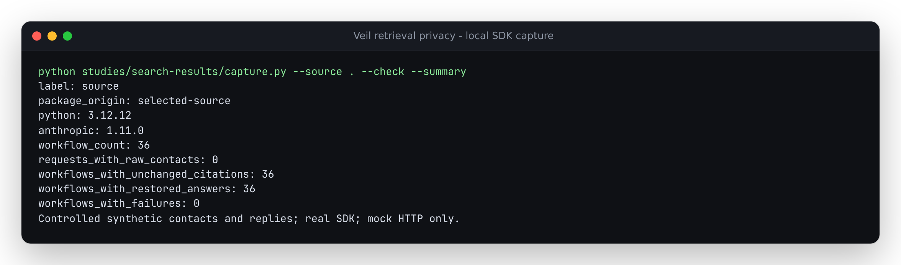

# Mask retrieval results before SDK serialization

At baseline `e3e9c5b8e4de72911f29241a353777b28d9398cf`, Veil traversed ordinary
text and inline document blocks but passed Anthropic `search_result` blocks
through. A recognized contact in a result title, source label or retrieved
paragraph therefore reached HTTP transport unchanged. All four synthetic
contacts were exposed in each of the 36 retained requests.

The correction visits those fields before serialization. The same 36 requests
now send surrogates, and their controlled echoed answers restore exactly.
This is a reproduced traversal defect, not a detector-recall benchmark or an
observed production disclosure.



## Supported contract

Anthropic's [search-result documentation](https://platform.claude.com/docs/en/build-with-claude/search-results)
specifies a text-block array, a title and an arbitrary source identifier. Results
can appear directly in user messages or inside a custom tool's result. The
installed Anthropic 1.11.0 SDK declares that content as an iterable of text
blocks. The fixtures use those forms with a real SDK and local mock HTTP.

| Field | Handling |
|---|---|
| `source`, `title` strings | Mask recognized values; no URL fetch |
| `content` iterable | Materialize once, mask text, preserve block order |
| `citations`, `cache_control` | Preserve settings |
| Tool IDs, result order, safe text | Preserve unchanged |
| Returned citation attribution and quotes | Preserve exactly as the provider supplied |
| Restored answer text and retained assistant history | Restore for the application; replay original provider blocks |

A credential-bearing source URL can become one `URL_CREDENTIAL` placeholder.
The source field is an attribution label, not a URL Veil dereferences. Its masked
form may no longer be a usable link. Applications can use their vault to restore
it explicitly; Veil does not silently rewrite provider citations.

## Reproduce

From this checkout:

```sh
uv sync --locked --group dev
uv run python studies/search-results/capture.py --source . --check --summary
uv run pytest -q tests/test_search_results.py
```

Omit `--summary` for JSON. To replay the baseline, use a separate checkout of
the baseline commit, point `--source` there and omit `--check`. To check an
installed wheel, omit `--source`; `package_origin` must be `environment`, and
the receipt lists SHA-256 hashes of every imported Python library file. The
script's shared test helper supplies only fixtures and HTTP envelopes; it
does not supply a masking implementation.

The [before receipt](results/before.json) and [after receipt](results/after.json)
cover **2 placements x 3 iterable forms x 3 invocation modes x 2 client types =
36 workflows**. Every request has a digest; six representative requests are
retained in full. Invocation modes are complete `create`, raw
`create(stream=True)` and the SDK streaming helper through Veil. Client types
are synchronous and asynchronous. Streaming answers use one-character chunks,
splitting every placeholder at every character boundary.

Each fixture has two retrieval results; the second contains three text blocks.
The controlled reply cites result index 1 and block range `[1, 3)`. The quote
is formed from those exact masked blocks. Both raw citation events and the
SDK's final snapshots retain that quote, source label, title and range.
Veil restores the answer text separately. No flattening, reordered blocks or
rewritten citation coordinates are needed.

The regression checks also cover a signed source URL, exact provider-block
replay after complete and helper-streamed replies, late literal collisions in
each new field, and failed iteration with an existing vault. Failed preparation
reaches no transport and restores the old vault. A one-shot iterator's
consumption cannot be undone; caller-owned reusable containers are not edited.

## Limits

No provider request or model inference is made by this study. It verifies SDK
serialization, parsing, restoration and replay, not remote API acceptance,
retrieval quality or model behavior. The contacts and replies are controlled
synthetic fixtures. The detectors retain their existing limitations.

This traversal is for inline `search_result` fields. Referenced resources,
opaque binary data, signed thinking and unrelated block types keep their
existing handling. Citations refer to masked text and attribution; applying
them to original text without an explicit mapping would be misleading.

This is a source correction. It does not publish PyPI, push source or deploy
the browser demo.

## Clean archive and installed artifacts

The [verification receipt](results/verification.json) records a clean archive
of implementation commit `512b107`, a locked Python 3.14.7 install with all
extras, lint/format/strict type checks, **1,017 passing tests**, and an sdist
with a wheel built from it. Every archived file still matches its git blob
after checks. The wheel's 33 Python library files match final source and
both isolated SDK installations exactly.

| Installation | Retrieval captures without raw contacts | Focused regressions |
|---|---|---|
| Python 3.12.12, Anthropic 1.11.0 | 36 of 36 | 65 passed |
| Python 3.10.21, Anthropic 0.40.0 | 36 of 36 | 61 passed, 4 skipped |
| Python 3.10.21, core wheel without SDKs | Not applicable | Library and installed CLI mask/restore round trips passed |

The [current-SDK receipt](results/installed.json) and
[minimum-SDK receipt](results/minimum.json) both confirm imports from the
isolated environment. Anthropic 0.40.0 predates search-result citation models:
complete-response extras and raw citation events survive, but helper-stream
citation snapshots are unavailable. Four helper replay checks explicitly skip
for that SDK. The initial clean suite used the same runtime bytes; subsequent
changes teach only the test helper to represent this older-SDK limitation.

The clean web checkout also passes install, TypeScript checks, production
build to `web/dist`, and **16 existing Chromium/Firefox browser scenarios**,
including 375px literal handling and offline masking/restoration. Those
scenarios exercise the browser's core Python; SDK integration checks run in
the separate Python environments. The terminal capture above was visually
inspected. No hosted assets were changed.
