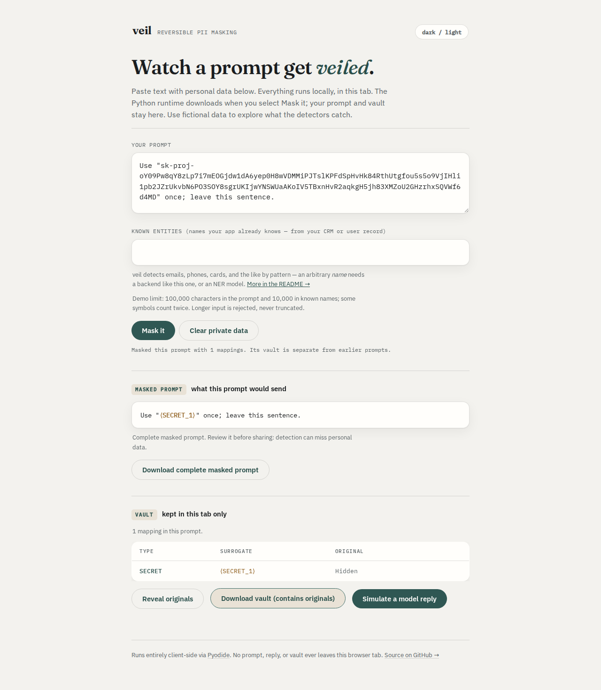

# Mask the complete token

At baseline `5521b571b401966220165628df26290b5d647e63`, a string consisting of
`sk-proj-` followed by 156 `a` characters passes through Veil unchanged. Random
URL-safe bodies can instead have only fragments masked. The legacy `sk-` rule
expects alphanumerics immediately after that prefix; the generic entropy
fallback has a 64-character candidate limit and does not establish coverage.

The corrected detector recognizes `sk-proj-` and `sk-svcacct-` followed by at
least 20 ASCII letters, digits, underscores or dashes, without a fixed upper
length limit. It takes the complete body before checking other known prefixes
that might occur inside it. Other known-key patterns and the generic entropy
heuristic are unchanged. This is source work, not a package release or hosted
demo deployment.

## Evidence and boundaries

[Official OpenAI example code](https://developers.openai.com/cookbook/examples/agents_sdk/session_memory)
uses the placeholder `sk-proj-...`. The
[service-account key reference](https://developers.openai.com/api/reference/typescript/resources/admin/subresources/organization/subresources/projects/subresources/service_accounts/subresources/api_keys/methods/create)
describes the returned value as a string; it does not specify a complete key
grammar. Neither source establishes the lengths or alphabets of issued keys.
`sk-svcacct-` is included as a compatibility-shaped recognition heuristic, not
as a format certified by those references.

Every input here is generated synthetic data. No credential was issued,
authenticated or sent to a provider. The 20-character minimum, alphabet and
prefix list are recognition choices; undocumented formats can still be missed,
and non-secret strings with these shapes will be masked. Quotes, spaces and
punctuation outside the body delimit matches. Adjacent URL-safe characters
belong to the same token and are masked with it. Short placeholders such as
`sk-proj-...` do not match this rule. This does not make Veil a credential
validator or a complete secret scanner.

The detector change is in `5d850ac`; `b5f819a` clarifies a comment without
changing executable code. The validation records below cover the final source.

## Controlled replay

[`cases.py`](cases.py) generates 68 deterministic shapes: two prefixes, three
body alphabets and ten lengths (20 through 4,096), plus trailing separators and
nested GitHub/Anthropic-shaped fragments. The complete default `Masker` must
replace exactly one whole token while retaining the surrounding sentence.

| Observed result | Baseline | Corrected source |
|---|---:|---:|
| Complete token masked | 12 / 68 | 68 / 68 |
| Complete token masked in actual SDK request body | 36 / 204 | 204 / 204 |
| Exact source restored from masked text | 68 / 68 | 68 / 68 |

[`replay.py`](replay.py) exercises the real OpenAI Chat Completions, OpenAI
Responses and Anthropic Messages SDKs over mock HTTP transports. All three
echo the outgoing text and must restore the original response. Five stream
chunk sizes also restore exactly. **Restoration passing does not prove that
masking happened:** unchanged leaked text can round-trip too.

The [before](before.json) and [after](after.json) receipts retain input/output
hashes, detector spans, complete-token vault coverage, normalized request-body hashes (sorted JSON keys)
and dependency versions. Raw synthetic token strings can be regenerated from
the driver. Mock echo behavior does not represent a model's behavior, and these
selected cases are not an estimate of recall on issued credentials.

The actual CLI has the same 12/68 to 68/68 improvement. [`cli.py`](cli.py)
invokes the executable 136 times, saves one vault per case, and restores each
masked stdout through that saved vault. Inputs include a final newline, as
the CLI documents newline-terminated output. All vaults round-trip in both
[before](cli-before.json) and [after](cli-after.json) captures.

## Browser and installed artifact

[`browser.mjs`](browser.mjs) runs the production Pyodide UI in Chromium and
Firefox, each at 375 and 1280 pixels. After the initial runtime download, every
case runs offline. Each run checks 272 prompt masks and 544 actual masked-text
and vault downloads. Baseline gives 48 complete masks; corrected source gives
272. There are no post-disconnection requests, page errors, CSP violations or
horizontal page overflow. All ten served application assets, including the
Python source manifest, are byte-compared against the build. The only external
requests are initial GETs for the configured Pyodide runtime.



Compare the [baseline desktop](../../docs/assets/secret-formats/before/chromium-1280.png)
and [corrected mobile](../../docs/assets/secret-formats/after/chromium-375.png)
captures. All eight retained images were opened and inspected. Complete
[before](browser-before.json) and [after](browser-after.json) browser receipts
include every case and served-asset hash. The demo's canned reply does not echo
secrets; secret restoration is checked by the library, SDK and CLI captures.

The [verification receipt](verification.json) records a fresh archive, locked
install, lint, formatting, mypy, full suite, sdist and wheel build. The suite
passes 498 checks on Python 3.10, 3.12 and 3.14, with the optional spaCy check
skipped. At the declared minimum SDK versions it passes 492, with seven skips
for spaCy and provider model features those old SDKs do not expose. The existing
browser suite also passes all 16 scenarios, including both themes, accessibility,
cancellation, retry, clearing and large downloads.

The final wheel is installed separately on Python 3.10 and 3.14, and with the
minimum SDK dependencies on Python 3.10. Each repeats all 204 transport calls;
complete case results agree across environments. All 34 installed Python source
files match the checkout. A Python 3.12 environment with only the wheel installed
repeats all 136 CLI calls, checking the dependency-free core. No registry package
was released; the locally built wheel retains the existing metadata version.

## Public-text compatibility

The [corpus receipt](corpus.json) covers all 1,483 files in the earlier study's
two technical manifests: 2,616,034 words, 32,925,796 bytes and 10,339 resolved
detections. Each cached source was hash-checked against its manifest. Every
resolved entity's type, span, detector, confidence and value was included in the
comparison; **no file's detections changed**. Values are hashed in memory rather
than redistributed. [Original sources and licences](../real-text/README.md#sources-and-licences)
remain in the earlier study. This corpus result does not establish false-positive
rates on other text.

[`scaling.py`](scaling.py) also checks single long bodies and repeated nested
prefixes at 10,000, 100,000 and 1,000,000 characters. Every input is one complete
secret. The [timings](scaling.json) retain one warmup and five timed calls per
shape for `SecretDetector.find` only. Million-character medians were 316.1 and
223.5 ms on 14-vCPU WSL2 Linux with 48 GB RAM amid other local work. These are
controlled measurements, not an end-to-end latency guarantee; the browser demo
has its separate 100,000-character prompt limit.

## Reproduce

```bash
uv sync --locked --group dev
uv run python studies/secret-formats/replay.py --source . --output /tmp/veil-keys-after.json
```

For the baseline, extract a Git archive of `5521b57` into a separate directory
and pass `--source /path/to/baseline --baseline`. Omitting `--source` imports
the installed wheel, allowing the same SDK capture outside the source checkout.
The SDK transports never make network calls.

With the original technical-text cache available, compare these receipts:

```bash
PYTHONPATH=/path/to/baseline/src uv run python studies/secret-formats/corpus.py studies/real-text/cache /tmp/veil-corpus-before.json
PYTHONPATH=src uv run python studies/secret-formats/corpus.py studies/real-text/cache /tmp/veil-corpus-after.json
```

The complete `rows` arrays must agree. Missing files or changed source hashes
stop the replay. The compact retained receipt records both aggregate row hashes
and the source manifest hashes.

Installed CLI and browser checks:

```bash
python studies/secret-formats/cli.py --bin /path/to/venv/bin/veil --output /tmp/veil-keys-cli.json
cd web
npm ci && npm run lint && npm run build
npm run test:browser
cd ..
node studies/secret-formats/browser.mjs web /tmp/veil-keys-browser --screenshots /tmp/veil-keys-shots
```

The browser driver requires Playwright's Chromium and Firefox installations and
network access for its initial Pyodide download. Pass `--baseline` to retain
coverage failures without rejecting the baseline run. Build output is `web/dist`.
