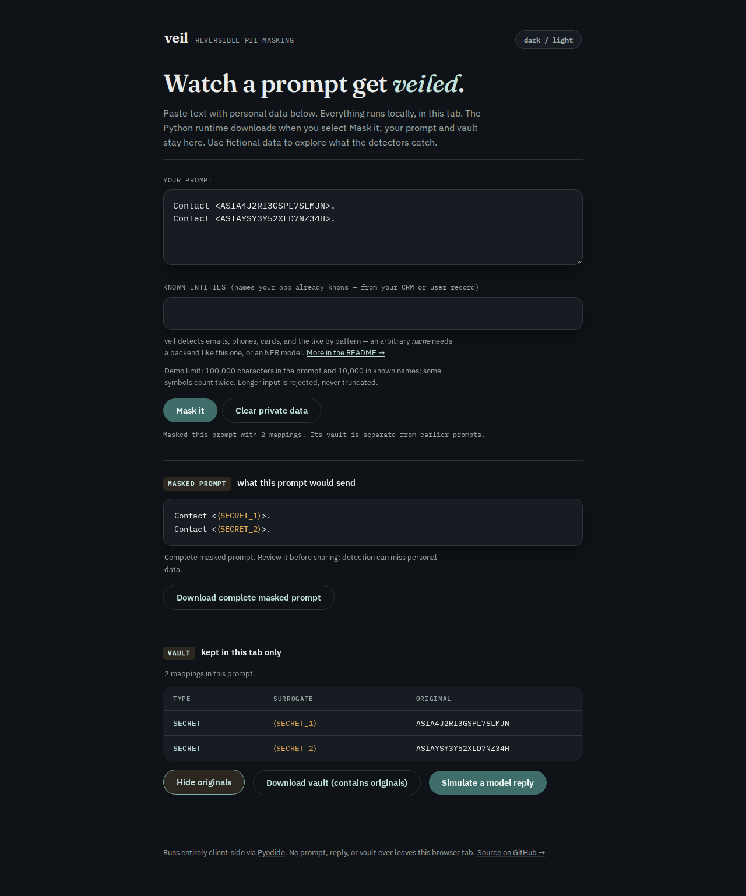
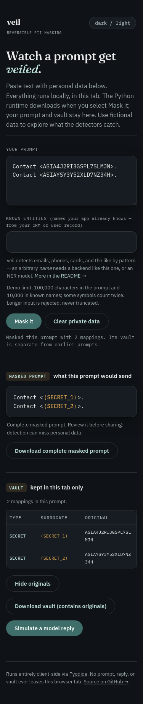

# Temporary AWS access key IDs must not depend on entropy

The known AWS key detector previously recognized only `AKIA`. Temporary `ASIA`
key IDs went through a generic entropy/word heuristic, which skipped some
complete IDs. The corrected source recognizes both prefixes with the same
20-character shape and whole-token boundaries.

[AWS documents](https://docs.aws.amazon.com/IAM/latest/UserGuide/reference_identifiers.html#identifiers-unique-ids)
`ASIA` as the temporary STS access key ID prefix. These IDs alone do not
authenticate: temporary credentials also need the secret access key and session
token. This change protects the recognized identifier; it does not claim to
cover every session-token shape, validate credentials or revoke exposed keys.

## Controlled reproduction

```sh
uv run python studies/sts-key-ids/replay.py --sdk --require-fixed --output /tmp/sts-after.json
uv run pytest tests/test_sts_access_keys.py
```

The replay generates 1,000 distinct 16-character bodies from `A-Z2-7`, using
seed `20261015`, and checks each under both prefixes. This matches the current
body alphabet used in the [Gitleaks AWS rule](https://github.com/gitleaks/gitleaks/blob/master/cmd/generate/config/rules/aws.go).
It is a **synthetic shape sample**, not an empirical distribution of issued
keys or a claim about production leak frequency. No AWS operation is called,
and the examples are not issued credentials.

| Observed behavior | Baseline `67e4100` | Corrected source |
| --- | ---: | ---: |
| `AKIA` IDs completely recognized | 1,000/1,000 | 1,000/1,000 |
| `ASIA` IDs completely recognized | 841/1,000 | 1,000/1,000 |
| `ASIA` IDs recognized by their known prefix | 0/1,000 | 1,000/1,000 |
| Actual SDK requests with every example masked | 0/12 | 12/12 |

[Before](results/before.json) and [after](results/after.json) retain counts,
detector provenance hashes and actual SDK request bodies. Four previously
missed synthetic `ASIA` IDs and one `AKIA` control pass through the real SDK
serializers: Chat Completions, Responses and Anthropic, each sync/async and
buffered/streaming. A local HTTP echo transport checks exact restoration and
makes no model call. The CLI/vault replay separately preserves CRLF bytes and
tests stream restoration at four chunk sizes for each example.

For a baseline replay, export `67e4100`, set `PYTHONPATH` to that archive's
`src/`, then use the current replay script without `--require-fixed`.

The shape rule intentionally keeps `AKIA`'s existing compatibility alphabet
`0-9A-Z`; adding `ASIA` does not change historical `AKIA` acceptance. It does
not recognize shorter/longer IDs or infer validity from the prefix. Glued word
characters cannot produce a shorter known-key match. Generic entropy scanning
remains a separate heuristic and can still find other token-like strings.
Other IAM resource prefixes such as `AIDA` and `AROA` are not newly treated as
known access keys. Higher-confidence whole mailbox and credential-URL
detections continue to enclose key-shaped substrings.

The [retained technical-corpus receipt](results/corpus.json) confirms zero
changed resolved detections across 1,483 files, 32,925,796 bytes and 2,616,034
words: all 10,372 keep their type, span, value, detector and confidence. This
checks collateral behavior on that corpus, not STS-key recall in production.

The change is unreleased; no PyPI release or manual hosted deployment was made.
Build the browser with `cd web && npm ci && npm run build` (`web/dist/`). The
existing browser harness accepts the retained secret fixture:

```sh
node studies/email-boundaries/check-browser.mjs web/dist studies/sts-key-ids/results/browser studies/sts-key-ids/browser-cases.json
```

## Clean and installed verification

Implementation commit `3d94646` was exported into a fresh directory. Python
3.14.7 with locked development dependencies and the spaCy extra passed Ruff,
formatting, strict mypy and **1,064 tests without skips**. The commands were
`uv sync --python 3.14 --locked --group dev --extra spacy`. All checks used
`uv run --no-sync`: `ruff check .`, `ruff format --check .`, `mypy` and
`pytest -q`; package building used `uv build`.
The archive's `.python-version` remains the developer default
3.12; `--no-sync` retained the explicitly installed supported 3.14 interpreter.
[Check output](results/logs/clean-checks.log) records that warning and the results.
The clean browser checkout passed type checking, build and all 16 existing
browser scenarios ([output](results/logs/clean-web-checks.log)).

The wheel was built from its sdist, then separately installed on:

| Environment | Seeded key-shape sample | SDK requests |
| --- | ---: | ---: |
| Python 3.14.7, OpenAI 3.31.0, Anthropic 1.14.0 | 2,000/2,000 | 12/12 |
| Python 3.10.21, OpenAI 1.66.0, Anthropic 0.40.0 | 2,000/2,000 | 12/12 |
| Python 3.12.12, no optional dependencies | 2,000/2,000 | Not installed |

Seeded detection/provenance hashes, CLI cases and outgoing SDK bodies match
source. The bare installation also produces the README quickstart's documented
output. All 35 runtime files match archive, sdist, wheel and installations; all
34 Python files match the browser manifest. Received browser assets match the
clean build. [Artifact receipt](results/verification.json). The verifier in
`../idna-mailboxes/verify-artifacts.py` checks these already-built artifacts
without installing or making network requests.

The [browser receipt](results/browser/receipt.json) covers six secret/control
cases in Chromium and Firefox at 375px and 1280px. The Python runtime initialized
online with a neutral prompt; the first credential mask and all downloads ran
offline, with zero new requests. The downloaded text and vault reconstruct the
source exactly. The demo's canned reply refers only to names/emails, so it
contains no secret surrogate; secret stream restoration is verified by the
native core and SDK replays, not inferred from that canned greeting.

All four secret screenshots were inspected: the masked values and vault remain
inside each viewport, and long IDs wrap in the mobile vault.





The final combined wheel also replays the earlier IDNA repair: all 101 core/CLI
cases and 12 SDK workflows pass on both SDK installations; the bare install
passes core/CLI. The final browser replays all 11 IDNA/control cases in both
engines and widths. [Combined-artifact cross-check](results/idna-final.json).
The existing IDNA screenshots were compared by hash and the final captures
were inspected again. Detailed build/install logs replace local scratch/home
path prefixes with placeholders; other output is retained.

The build output remains `web/dist/`. Neither PyPI nor the hosted site was
updated. Suggested repository description and topics remain those of the
existing reversible PII masking tool.

## Public source

Source/evidence revision `087b682` was pushed to `main` after verification.
All 66 changed files match their pinned public GitHub raw-file bytes
([receipt](results/public-source.json)); the working tree was clean and the
remote `main` matched at verification. The remote `gh-pages` revision remained
`8a15aaf198636907a1254f247f2159c6a53984d9` across this source push. No package
release or manual site deployment is part of this verification.
