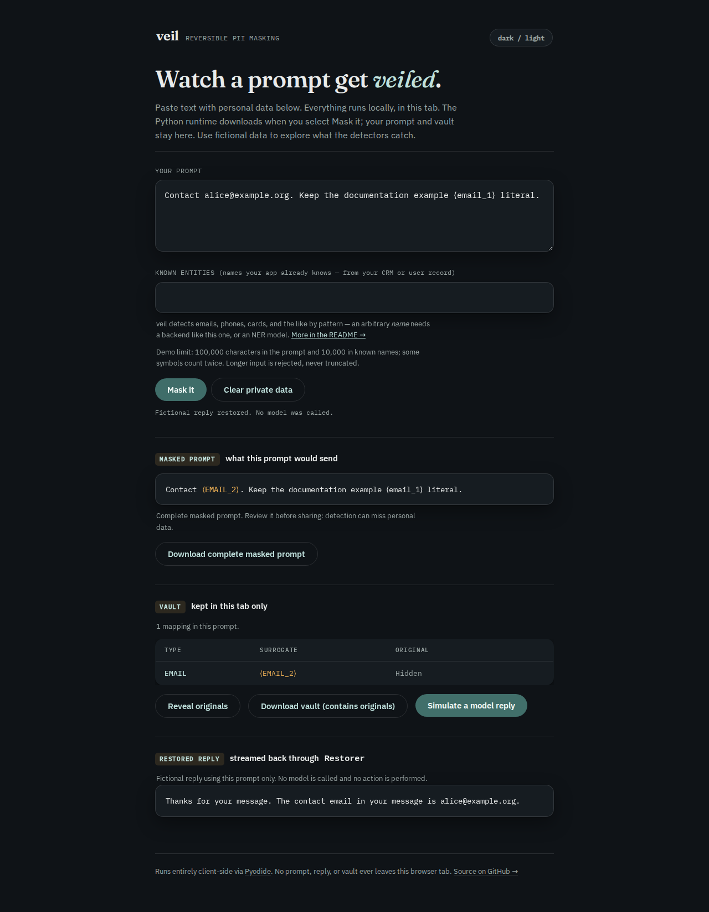

# A literal token is not an identity

At baseline `5758fd0`, masking `Contact alice@example.org; example ⟨EMAIL_1⟩`
produced `Contact ⟨EMAIL_1⟩; example ⟨EMAIL_1⟩`. Restoration changed both
occurrences into the address. With realistic replacements, `alice@example.org`
could instead become `user1@example.org` even when that second address was
another original in the same input.

Source commit `21ce9c4` reserves literal spellings before allocating replacements
and checks reversibility before returning a prepared batch. This is source
work, not a PyPI release or a claim about the hosted demo.

## Controlled results

All inputs in these captures are fictitious. No model was called.

| Case | Baseline | Corrected source |
|---|---|---|
| Email plus literal placeholder | Both restore to the email | Allocates the next available token; literal stays literal |
| Lowercase or adjacent literal placeholder | Tolerant restoration changes it | Literal preserved |
| Realistic replacement equals another source address/name | Original remains in outgoing masked text | Another replacement is selected |
| Related texts contain a literal token in either order | Later mapping can change the earlier literal | `mask_many` reserves all submitted texts first |
| Reused vault plus an already-bound literal | Literal becomes the bound original | `VaultError`; vault unchanged |
| CLI rejection after an earlier saved mapping | Replaces output and extends the vault | Exit 2; both files retain their bytes |
| Collision in a later SDK request field | Request reaches the transport | Refused before transport; vault unchanged |

[`replay.py`](replay.py) retains 23 library and actual CLI cases, checking
exact/tolerant restoration, single-character streaming, output bytes and vault
state. The [baseline](results/before.json) disagrees with 18 case contracts;
the [corrected source](results/after.json) satisfies all 23. Four baseline
cases reuse an original as a replacement. These are controlled behaviors,
not estimates of collision frequency in user traffic.

[`sdk_replay.py`](sdk_replay.py) uses the real OpenAI and Anthropic Python SDKs
over mock HTTP echo transports. Every request body, parsed/restored reply and
rejection is retained. The [nine baseline cases](results/sdk-before.json)
all violate their contracts; the [corrected capture](results/sdk-after.json)
has three reversible echo calls and six rejections with zero HTTP requests.
Separate regression checks cover sync/async create, create-with-stream and
stream entry points. Provider response envelopes come from
[`tests/sdk_wire.py`](../../tests/sdk_wire.py); an echo is not a model's behavior.

The request boundary includes separately supplied text. For example, the
[Responses API](https://developers.openai.com/api/reference/python/resources/responses/methods/create)
has separate `input` and `instructions` parameters; validating only `input`
would miss a collision in the latter. Existing signed/replayed blocks remain
outside raw-text masking.

## Browser behavior

The production browser build runs the same Python through Pyodide. Chromium
and Firefox at 375 and 1280 pixels keep the literal `⟨email_1⟩` while assigning
`⟨EMAIL_2⟩` to the address. The actual masked-text and vault downloads are
checked, and a fictional reply is restored from streamed chunks. The reply
does not echo the whole prompt; full-prompt round trips are checked separately
by the Python and SDK captures.



The [mobile capture](../../docs/assets/surrogate-collisions/chromium-375.png)
and [browser record](results/browser.json) cover the same workflow. The
existing browser suite also checks keyboard access, offline reuse, cancellation,
retry, private-data clearing and exports in both themes. The complete run has
16 scenarios, with accessibility, overflow and CSP checks.

## Public-text compatibility

[`corpus.py`](corpus.py) replays every file in the earlier real-text study's
two technical manifests. Each cached source is hash-checked first. There are
1,483 files, 32,925,796 bytes and 1,538 mappings, with a fresh vault per file.
Both [baseline](results/corpus-before.json) and
[corrected source](results/corpus-after.json) restore every file exactly and
tolerantly, with no refusals. Their output-ledger hashes agree: every masked
text, mapping and round-trip result is unchanged. Source text and vaults from
that corpus are not redistributed here; [provenance and licences](../real-text/README.md#sources-and-licences)
remain with the original study.

This checks compatibility on those particular logs and repositories. It does
not measure personal-message detection accuracy or prove the absence of future
collisions. The extra checks also cost work: the retained single runs took
36.762 and 47.060 seconds on 14-vCPU WSL2 Linux with 48 GB RAM, respectively.
These were sequential local runs amid other activity, not isolated benchmarks.

## Scope and limits

- `mask(text)` checks that text. `mask_many(texts)` reserves all supplied raw
  texts before masking and validates every result against the final vault.
  Originals already known to the vault are also reserved as replacement values.
- Source reservations are discarded after a batch. Include the complete raw
  conversation when adding turns. A literal in an earlier, omitted source is
  unavailable to the allocator. Provider-held history is similarly unavailable.
- Wrappers group the raw strings they actually mask into one request boundary.
  If a later field introduces a collision, preparation raises before the SDK
  call. A fresh vault with a placeholder template absent from the complete
  request can resolve it. Pre-masked strings are not raw input to a wrapper.
- Existing mappings never change identity. A conflicting reused mapping is an
  error. Allocation is bounded to 1,024 attempts, so a custom generator with
  no available value cannot loop forever.
- Failure rolls back library-owned vault mappings, counters and restore caches.
  It cannot roll back arbitrary side effects in custom detectors/generators,
  undo earlier successful requests, or coordinate concurrent vault writers.
- Exact and tolerant round-trip checks apply to the unchanged prepared text.
  They do not prove what a model will invent, rewrite or reference. Streamed
  restoration remains exact. Direct `Vault.get_or_create` and standalone restore
  operations have no source context unless the caller supplies allocation constraints.
- PII detection is unchanged and can still miss values. Avoiding a collision
  does not establish that a prompt contains no remaining personal data.

## Reproduce

```bash
uv sync --locked --group dev
uv run python studies/surrogate-collisions/replay.py --source .
uv run python studies/surrogate-collisions/sdk_replay.py --source .
```

Pass `--source /path/to/baseline` to repeat against an archive of `5758fd0`.
Without `--source`, the scripts import the installed package; this is how the
wheel checks are run. `corpus.py --source .` additionally needs the cached
files described by the earlier study. It refuses changed/missing files.

```bash
cd web
npm ci && npm run build
VEIL_COLLISION_SCREENSHOTS=/tmp/veil-shots npm run test:browser
```

Chromium and Firefox must already be installed for Playwright. The first
mask downloads the configured Pyodide runtime; prompt/vault data is processed
locally. [Clean builds and installed-wheel evidence](results/verification.json)
record the exact artifact hashes, commands and runtime versions.
