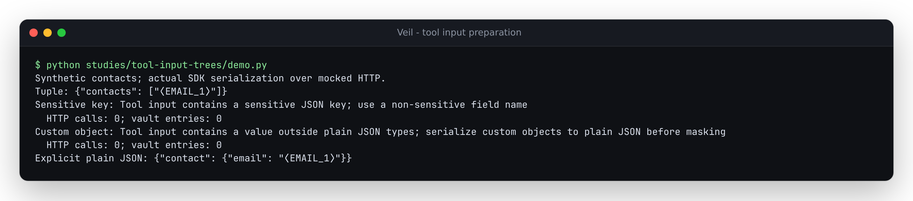

# The SDK serialized text the masker never visited

At baseline `a67a5b6`, Anthropic tool input masking visited strings, lists and
dictionaries, then passed every other Python value through. That was earlier
than the SDK's own serialization. A tuple of contacts became an ordinary JSON
array **after** masking and carried its raw addresses to transport. A nested
Pydantic model also became a JSON object containing an unvisited raw email.
Detected email keys and numeric card-shaped keys could cross the same boundary.

The reproduction uses the actual Anthropic SDK, with a mocked HTTP transport
that records its request bodies. Contacts, card-shaped numbers and replies are
synthetic; no inference or live server acceptance is involved.

| Fresh tool input | Baseline wire/preparation | Corrected behavior |
| --- | --- | --- |
| Tuple containing contact strings | SDK emits unmasked JSON array | Recursively masks entries; emits the same array shape |
| Email address used as object key | Raw key sent | Detected sensitive key rejects before transport |
| Numeric card-shaped object key | SDK turns it into raw string key | Requires string keys before masking |
| Nested custom model object | SDK dumps its hidden raw email | Requires explicit conversion to plain JSON first |
| Literal surrogate inside a tuple | Never reserved; can collide with an earlier replacement | Participates in request collision checks; failed preparation rolls back |
| Ordinary JSON tree or explicitly dumped model | Masked normally | Unchanged |
| Retained provider-owned tool input | Exact original history replay | Unchanged; edited keys enter fresh masking |

The correction visits lists and tuples, string-keyed dictionaries and finite
JSON scalar values. It checks the keys it will actually copy, refuses detected
sensitive keys rather than changing their meaning, and rejects unvisited custom
objects. Domain models can enter the supported path explicitly:

```python
tool_input = {"contact": contact.model_dump(mode="json")}
```

This is a preparation boundary, not a codec for every object the SDK might
serialize. It does not infer which dictionary keys are schema names versus
data identities. Use non-sensitive field names and keep sensitive identifiers
in string values. The official [Messages API reference](https://platform.claude.com/docs/en/api/messages/create)
defines tool-use input; its wire schema does not establish that an arbitrary
Python object was examined by a privacy wrapper.

## Reproduce

```sh
uv sync --locked --group dev
uv run --no-sync python studies/tool-input-trees/replay.py --src src --out /tmp/tool-input-trees.json
```

Export `a67a5b6` into another directory to inspect the baseline without changing
this checkout, then pass its `src/` to the replay and add `--observe-only`.
The replay checks the imported product path, records its runtime source hash,
and retains actual SDK request bodies, errors, vault counts and unchanged caller
inputs. Complete, raw-stream and SDK-helper-stream entry points run both
synchronously and asynchronously.

[Before](results/before.json) has 30 disagreements across 44 workflows, with
24 fresh request cases carrying recognized raw identifiers. [After](results/after.json)
has no disagreements and no such fresh raw-value cases. The corpus includes
ordinary JSON and explicitly serialized-model controls, plus exact provider
history replay. It checks arbitrary-precision integer values, booleans, null
and finite floats without converting their types.

The regression suite also checks invalid nonfinite JSON numbers, request-wide
rollback, error messages that do not repeat the contacts, and edits to real
returned SDK tool-use objects. Those edits cannot revive provider-history
replay after their keys change.

## Installed artifact verification

The [verification receipt](results/verification.json) identifies source commit
`b60ee9d`, the wheel and source-archive hashes, and the retained clean-check logs.
A fresh archive passed lint, format, type checks, 701 Python tests with spaCy
included and no skips, package/web builds and all 16 existing Chromium/Firefox
demo scenarios, including offline reuse. All 34 runtime files match that source,
the wheel, source archive, three installations and browser manifest.

| Installed environment | SDK replay | Additional regressions |
| --- | --- | --- |
| Python 3.14.7 / Anthropic 1.11.0 | [44 workflows; zero disagreements or fresh raw-value cases](results/installed-current.json) | 35 passed |
| Python 3.10.21 / Anthropic 0.40.0 | [44 workflows; zero disagreements or fresh raw-value cases](results/installed-floor.json) | 35 passed |
| Python 3.12.12 / core wheel only | Documented mask/restore example passed; optional SDKs absent | Not an SDK run |

The 14 ordinary JSON, explicitly serialized-model and provider-history controls
have exactly the same captured request bodies before and after the repair.
The [terminal capture](../../docs/assets/tool-input-trees.ansi) comes from
`python studies/tool-input-trees/demo.py` run against the installed current wheel,
with the actual SDK serializing synthetic tool inputs over mocked transport.



## Boundaries

Key detection uses the configured detectors and name backends; it is not
exhaustive. Numeric values remain numeric and are not anonymized. Opaque
PDF/image data and references, signed thinking blocks, calls on the underlying
unwrapped SDK and provider-produced history have their existing limits.
Provider replay can contain text the provider itself already produced; it is
excluded from the fresh-caller raw-value count. Response restoration still
leaves object keys unchanged.

This source correction has no corresponding PyPI release or verified hosted
deployment. Build the local package with `uv build`. Build the browser demo with
`cd web && npm run build`, producing `web/dist/` and a copy of the Python source
used by its existing demo workflows.
